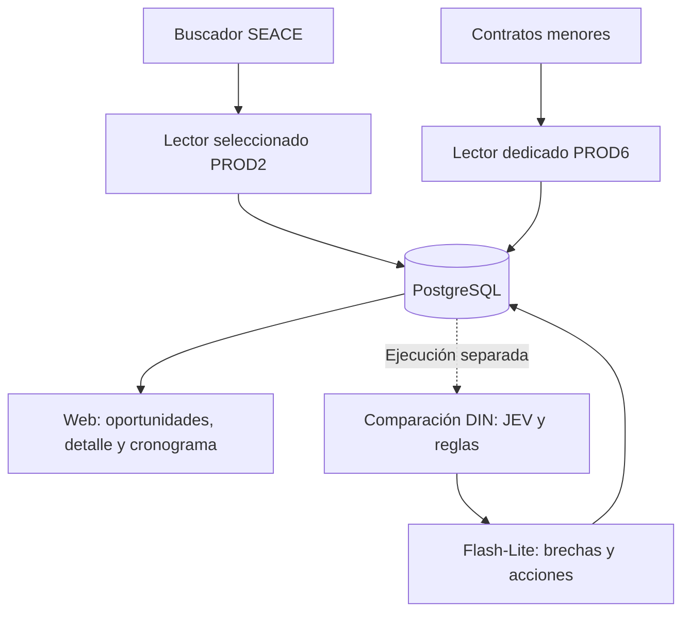

# Contexto de BuenaPro

Documento de continuidad del proyecto, consolidado el **21/10/2026, hora de Lima**. Reúne producto, arquitectura, decisiones y pendientes para retomar el trabajo sin depender del historial del chat. Los estados y cantidades corresponden a los cortes indicados; no son una consulta permanente de producción.

## 1. Qué es y qué busca resolver

BuenaPro ayuda a empresas proveedoras peruanas a encontrar contrataciones públicas, entender los requisitos, comparar sus capacidades y organizar una postulación. La decisión debe conservar su evidencia: documento, página, fuente, fecha y estado de revisión.

Las dos fuentes principales de la experiencia actual son **Buscador SEACE (PROD2)** y **Contratos menores (PROD6)**. La pestaña anterior de Concursos SEACE/PROD4 fue retirada de la navegación; sus datos y código históricos siguen conservados. No confundir los números internos de fuente con ambientes distintos de producción.

El principio técnico del proyecto es:

> LLM para leer y estructurar. Reglas para comparar. LLM opcional para explicar.

Una recomendación no acredita elegibilidad ni equivale a probabilidad de ganar. Un título parecido, una ficha publicada y una lectura completa son estados diferentes. [PRODUCT.md](PRODUCT.md) define el propósito; [AGENTS.md](AGENTS.md) contiene las reglas de trabajo.

## 2. Repositorio y entorno

- Checkout de trabajo: `/Users/robertquispe/Projects/Me/Licita/BuenaPro`.
- Remoto: [VEYON-DEV/BUENAPRO](https://github.com/VEYON-DEV/BUENAPRO).
- Rama de esta continuidad: `codex/prod2-parallel-discovery-prep`.
- Base documental previa a este contexto: `7d720b0`. Consultar `git log -1` para la revisión posterior; el commit documental no sustituye el commit de código de una imagen publicada.
- Web pública: [buenapro.veyon.dev](https://buenapro.veyon.dev).

| Ubicación | Responsabilidad |
|---|---|
| `apps/web/` | Next.js, React, TypeScript, API, autenticación y frontend |
| `apps/web/server/` | PostgreSQL, sesión/tenant y servicios de negocio del servidor |
| `apps/web/features/` | Vistas y componentes organizados por dominio |
| `workers/seace/` | Python 3.12+, clientes de fuentes, lectura documental y matching |
| `scripts/` | Ejecutores opt-in, lotes finitos, QA y herramientas de operación |
| `infra/docker/` | Dockerfiles y Compose de web, infraestructura y lectores dedicados |
| `packages/shared/` | Espacio compartido del monorepo |
| `docs/` | Contratos, decisiones, resultados y guías |
| `tasks/` | Backlog y verificaciones completadas por área |
| `tmp/` | Entradas y recibos privados locales de operaciones; fuera de Git |

PostgreSQL es la fuente de verdad. Redis se usa en determinados flujos, especialmente la cola del lector seleccionado PROD2. El Compose base usa PostgreSQL 16 y Redis 7. Las versiones efectivas de dependencias web están fijadas por el lockfile; no deducirlas del valor `latest` de algunos campos del manifiesto.

Los secretos pertenecen a `.env.local` y a la configuración privada de cada servicio. No incluir claves, cookies, tickets temporales, recibos privados ni documentos empresariales en un commit o en el contexto de construcción Docker.

## 3. Arquitectura de las dos fuentes



### PROD2: mapeo y lectura son herramientas distintas

El mapeador paralelo descubre metadatos y compara `id_convocatoria`, conservando `id_procedimiento`, y el hash del listado. Distingue nuevo, igual, cambiado y conocido sin baseline comparable. No fusiona convocatorias por tener el mismo título. No descarga bases, llama modelos, usa Redis ni publica automáticamente oportunidades.

El lector seleccionado recibe un alcance de búsqueda o IDs de un handoff explícito. Puede reutilizar antecedentes y decisiones compatibles. En búsqueda ordinaria, filtra con JEV antes de enriquecer ficha. En la modalidad de IDs seleccionados, comprueba primero ficha y apertura antes de nuevos modelos; las lecturas preservadas pueden evitar JEV. Los lotes actuales admiten JEV comercial de al menos 60 antes de avanzar a lectura nueva.

Los candidatos aceptados pasan por ficha, cronograma, inventario y selección de documentos; preparación de texto y OCR local parcial; recuperación de contexto con embeddings V5; y Gemini LLM1 para requisitos estructurados con citas. Un contexto insuficiente queda en revisión, sin sustituirlo automáticamente por un PDF completo o por otro modelo. Redis organiza el trabajo pendiente; PostgreSQL conserva resultados, identidades y reservas.

El servicio automático PROD2 envuelve al lector seleccionado, no al mapeador paralelo. Exige alcance, ventana móvil en hora de Perú, intervalo, primer ciclo y máximos finitos explícitos. Espera después del cierre válido de cada ciclo. El mapeador y el lector comparten exclusión de coordinador: no deben ejecutarse simultáneamente como dos coordinadores PROD2.

### PROD6: descubrimiento por perfil y lectura de menores

Busca bienes y servicios en estado nativo vigente, verifica el año de publicación y filtra mediante segmentos CUBSO y palabras de líneas comerciales activas. Exige una frase configurada o dos términos de una misma línea; no usa el filtro JEV de 60 de PROD2. Descarta cierres conocidos vencidos; una fecha desconocida no demuestra apertura.

Deduplica por `id_contrato`, consulta ficha/etapas/archivos y reutiliza extracciones compatibles. La ruta dedicada actual lee PDF de categoría 1, TDR/EETT; otros anexos pueden quedar listados. No tiene la conversión Word/ZIP/RAR del lector seleccionado PROD2.

Su cola está en PostgreSQL, aislada por fuente y perfil. Admite trabajos de ficha, descarga, extracción y resumen. La espera predeterminada es de 30 minutos **después** de cada ciclo; por defecto tiene tres búsquedas, dos trabajos de entrada/salida y una lectura pagada simultánea. El perfil de descubrimiento es una configuración propia: no asumir que ya cubre todas las líneas DIN.

Los lectores son independientes, aunque compartan PostgreSQL y proveedores. Ninguno activa por sí mismo el matching DIN ni las notificaciones. La [guía de ambos lectores](docs/guia-lectores-seace-menores.md) detalla código, diferencias, errores y cadencia.

## 4. Datos, identidad y documentos

La información de cada fuente conserva sus IDs oficiales y su vínculo canónico de oportunidad. Fichas, cronogramas, extracciones, requisitos, clasificaciones, evaluaciones y recibos no son intercambiables. Una publicación de metadatos no debe inventar detalle, calendario, documentos ni puntaje.

La empresa evaluada se identifica por tenant, perfil y hash vigentes. Un contexto comercial conjunto de descubrimiento —por ejemplo, VEYON y DIN— no prueba capacidad individual de DIN. No copiar evidencias, experiencia ni resultados entre empresas por compartir una búsqueda.

Los originales nuevos de SEACE se descargan únicamente para análisis temporal. PostgreSQL conserva resultados, UUID, hashes, referencias oficiales y trazabilidad. Al descargar de nuevo se resuelve un ticket fresco; no persistirlo. **No crear originales PDF/ZIP/RAR/Word nuevos en R2.** R2 conserva sus usos auxiliares y respaldos históricos existentes.

Una entrada pendiente, una revisión o un pago incierto conserva sus archivos necesarios para recuperar sin repagar. Solo limpiar temporales propios cerrados después de comprobar persistencia; nunca barrer carpetas compartidas, recibos o colas históricas.

## 5. Modelos y evaluación DIN

| Componente | Uso |
|---|---|
| JEV `jev-1.13.0` | Afinidad comercial, selección documental o decisiones de capacidad, según el ejecutor |
| OpenAI `text-embedding-3-small`, 1536 dimensiones | Vectores para recuperar texto relevante en la lectura V5 PROD2 |
| Gemini LLM1 | Leer/estructurar requisitos y evidencia; modelo y política ligados a cada plan |
| Reglas locales | Aritmética, estados, agregación y puntaje de capacidad |
| Gemini `gemini-3.1-flash-lite` | Explicar brechas y acciones DIN en el flujo JEV/reglas, sin cambiar su puntaje |

El usuario eligió Flash-Lite para recomendaciones por rapidez después de la limitación de cuota de Gemma. Algunos nombres de archivos conservan `gemma` por compatibilidad: el proveedor/modelo real se consulta en metadata y recibos. No cambiar de modelo o habilitar fallback sobre un plan congelado.

La evaluación DIN usa rubro, experiencia relevante, experiencia económica compatible y profesionales. El flujo JEV/reglas tiene pesos 20/30/30/20, con reponderación de criterios no aplicables. Compara moneda, período, participación y respaldo; un monto contractual total no equivale automáticamente a experiencia computable. Una diferencia pequeña frente al mínimo debe expresarse numéricamente y con una acción posible, sin declararla cumplida.

RUC, RNP, CCI, declaraciones y formatos rutinarios van al checklist, sin bajar el puntaje de capacidad. Las brechas deben indicar qué pide la entidad, qué acredita DIN, qué falta y qué acción concreta corresponde. No inventar experiencia IA por haber suministrado software industrial: el antecedente BCRP revisado acredita SCADA, no por sí solo proyectos de IA.

La biblioteca DIN tuvo 43 documentos leídos y texto persistido por documento; el contexto del matching usa resúmenes, hechos y evidencia estructurada. No debe volver a leer sus PDFs por cada evaluación ni cortar silenciosamente contratos o requisitos para pasar un límite. Véanse [lectura empresarial](docs/dinaut-document-reading-20261013.json) y [contrato de matching](docs/matching-three-dot-batch.md).

Una lectura ausente, fallida, vacía u obsoleta no está lista para LLM2. Una lectura bajo revisión puede producir un resultado provisional solo si el ejecutor y su plan lo admiten, conservando esa revisión. **«Por leer» queda excluido.**

## 6. Categorías, afinidad, puntaje y frontend

Son tres señales distintas:

- **Categoría:** tipo comercial de la contratación; por título es preliminar y no depende del perfil DIN.
- **Afinidad:** semejanza del objeto con las líneas de una empresa; no exige que el expediente ya esté leído.
- **Puntaje documental:** comparación de requisitos leídos con evidencia de la empresa; puede conservar revisión o cobertura parcial.

El selector simple tiene seis categorías, además de Todas:

| Etiqueta | ID de filtro |
|---|---|
| Licencias y suscripciones | `licencias_suscripciones` |
| Desarrollo de software | `desarrollo_software` |
| IA y automatización | `ia_automatizacion` |
| Industrial | `industrial` |
| Cloud e infraestructura | `cloud_infraestructura` |
| Soporte y mantenimiento | `soporte_mantenimiento` |

Una oportunidad puede tener varias categorías; sus conteos no se suman como filas únicas. La clasificación documental válida prevalece sobre la de título. Los ambiguos se muestran Por confirmar; no forzar una categoría para llenar el filtro. El [catálogo versionado](workers/seace/src/buenapro_worker/extraction/commercial_categories.v1.json) y el [diseño de clasificación](docs/opportunity-classification.md) definen la proyección.

Las categorías se filtran antes de contar y paginar. En PROD2, elegir categoría la aplica inmediatamente y conserva perfil, búsqueda y tipo; comparte el borrador con Buscar para evitar una carrera de navegación. En menores se conserva aplicación manual para combinar controles. «Con puntaje» es distinto de afinidad por título; los puntajes documentales válidos del perfil se priorizan antes de paginar.

Las bandas visuales son rojo por debajo de 30, amarillo de 30 a 80 inclusive y verde por encima de 80. Un cero válido debe verse; una nota ausente no se inventa. Verde provisional no significa evaluación aprobada. Lista, inspector y detalle deben mantener el mismo perfil y resultado.

La experiencia actual muestra SEACE primero y menores después. Hay columnas de categoría, subcontratación, consorcio, fecha y análisis/afinidad. El detalle permite consultar texto y requisitos completos. En Cronograma, PROD2 muestra las guardadas con ofertas abiertas y sus etapas oficiales; guardar no actualiza la fuente. Menores tiene sus propias reglas de guardadas/afinidad/evaluación. [Spec del cronograma](docs/frontend/13-cronograma.md).

La UI sigue BuenaPro Glass: violeta para selección, negro para acción primaria, superficies legibles y revelado progresivo. Vistas delgadas en `app/`, implementación por dominio en `features`, API pública de cada dominio y CSS Modules. Antes de modificar UI se deben leer las referencias y skills exigidas por [AGENTS.md](AGENTS.md), [DESIGN.md](DESIGN.md) y la [arquitectura frontend](docs/frontend/architecture.md). El cierre visual exige capturas reales desktop/laptop/mobile según la vista.

## 7. Qué terminó en los lotes del 20/10

### Mapeo general

Se completaron 183 keywords —166 originales y 17 variantes— por 23 años y dos objetos: **8.418 combinaciones, 1.736 IDs únicos**. El resultado es metadatos, no vigencia ni lecturas. El mapeo quedó cerrado; no repetirlo para continuar una selección documental. [Resultados](docs/prod2-parallel-discovery-execution-20261020.json).

### Recorrido original de 157 IA/industrial

Terminó operativamente en 16 ciclos, con su cola drenada y reservas terminales. Distribución: 71 rechazos JEV, 57 cerrados, 17 aperturas no confirmadas, ocho revisiones de contexto, una selección documental pendiente y tres históricos preservados. **Ese recorrido produjo cero LLM1 y matches nuevos.** Sus 26 pendientes y 48 holds externos se conservaron. Las 1.531 exclusiones por título no son rechazos JEV. [Cierre original](docs/ia-industrial-execution-20261020.md).

### Continuidad posterior de esos mismos IDs

Los 157 metadatos fueron publicados: 144 nuevos y 13 preservados. Se calcularon las 157 afinidades comerciales individuales DIN. Esto no son 157 lecturas completas ni 157 evaluaciones documentales.

De las nueve recuperaciones documentales: dos lecturas quedaron persistidas con revisión —extracciones 550 y 551—, tres respuestas conocidas terminaron `MAX_TOKENS` y cuatro casos no se enviaron. No repetir ninguna respuesta pagada. El LLM2 nuevo no se ejecutó: su preparación excedió límites locales JEV de 64.000 tokens por solicitud/32.000 por pregunta y Flash-Lite de 30.000 para explicación. Es un guard de entrada, no un rechazo de cuota del proveedor.

El particionador JEV puro está probado pero aún sin integrar. Falta un plan conjunto de transporte, cobertura, recibos y costos por parte, y resolver también el contexto del explicador; dividir solo JEV no desbloquea el flujo completo. El [seguimiento posterior](docs/prod2-sector-followup-20261020.md) tiene prioridad sobre cortes intermedios del lote original.

### Clasificación por título

El backfill inicial cubrió las 1.135 filas PROD2 del corte: 808 con categoría, 322 Por confirmar y cinco Otros. Después se completó la proyección de los 157 seleccionados: 61 con categorías, 21 Otros y 75 Por confirmar; 156 etiquetas por título y una documental. La selección inicial «154 industrial y 3 IA» era un criterio léxico de selección, no su clasificación semántica final.

No sumar estos cortes al inventario del mapeo ni presentarlos como fuentes disjuntas. Las 1.135 filas tampoco son un censo actual tras las publicaciones posteriores. [Backfill](docs/prod2-title-categories-execution-20261020.md) y [cobertura de los 157](docs/prod2-selected-title-category-results-20261020.json).

## 8. Costos conocidos e incertidumbres

Importes calculados desde uso y recibos de los lotes, sin conciliación de factura ni infraestructura/OCR. No son una cotización vigente para futuras llamadas.

| Operación | Costo conocido USD | Alcance |
|---|---:|---|
| Recorrido original IA/industrial | 0.014445514 | 55 JEV y 18 embeddings; cero LLM1 nuevos |
| Afinidad comercial DIN de 157 | 0.01006845 | 157 decisiones JEV |
| Continuidad documental de nueve | 0.1578859 | Cinco solicitudes LLM1 conocidas; cuatro no enviadas; cero embeddings nuevos |
| Backfill inicial por título | 0.040442136 | 1.018 peticiones únicas para 1.135 filas |
| Completar categorías de los 157 | 0.005883528 | Costo nuevo de 143 peticiones; 14 respuestas reutilizadas |

Los costos históricos reutilizados son informativos y no se suman de nuevo como gasto incremental. Las tres evaluaciones de continuidad técnicamente `uncertain` por parseo tienen respuesta y uso conocidos. Son distintas de **seis pagos históricos de otros lotes cuyo costo sigue desconocido**.

El agotamiento de créditos OpenAI diagnosticado el 13/10 tuvo recuperación verificada tras la recarga humana. No presentarlo automáticamente como bloqueo actual. No comprar créditos, cambiar límites, repetir inferencias o hacer pruebas de modelos para sondear estados sin cambios. Un recibo conocido puede recuperarse localmente si sus identidades coinciden; una llamada incierta no se repite por cambiar de carpeta.

## 9. Producción: código publicado frente a servicios activos

| Componente | Última evidencia registrada | Estado |
|---|---|---|
| Web | Código `f2d55386243d1bd7d62b4431c2b779a2430dd53c`, imagen `buenapro-web:category-search-f2d5538` | Publicación verificada el 20/10, 606 hashes runtime coincidentes |
| PROD2 | Imagen `buenapro-worker-prod2:service-2b1b0d6` | Contenedor `created`, detenido |
| PROD6 | Imagen `buenapro-worker-prod6:pg-guard-5950706` | Contenedor `created`, detenido |

El estado Docker de ambos lectores se comprobó el **21/10 a las 22:10 Lima**, sin repetir consultas de fuente o modelos. Los dos tienen `restart: no`. Tener el código de ciclos implementado no acredita ejecución automática activa. Las imágenes de lectores son anteriores a mejoras del checkout local; desplegar web no las reconstruye.

Los diagnósticos de acceso anteriores conservaron HTTP403 desde la VM para ambas fuentes y desde Mac para PROD6; el mapeo PROD2 sí funcionó manualmente desde Mac el 20/10. No generalizar ese acceso a la VM ni dar por resuelto el bloqueo sin evidencia nueva. Hoy no se volvió a probar SEACE. PROD2 también necesita configuración privada activa de alcance, ventana y límites.

Fuentes: [web y filtros](docs/prod2-category-filter-fix-20261020.md), [estado Docker](docs/evidence/readers-architecture-status-20261021.json), [consolidación de lectores](docs/readers-consolidation-20261019.json). Los cinco contenedores legacy scheduler/io/llm/match/notify se retiraron; imágenes y evidencia histórica se conservaron. No reactivarlos para iniciar los dos lectores dedicados.

## 10. Cómo desarrollar y publicar

Antes de trabajar: leer `tasks/README.md`, revisar rama y diff y localizar la tarea correspondiente. Implementar localmente, validar, actualizar documentación y marcar solo el checkbox verificado. El backlog conserva historia: una tarea pendiente intermedia puede haber sido superada por un informe de cierre posterior; contrastar fechas y resultados.

Comandos de desarrollo web existentes, desde la raíz y con entorno local ya configurado:

```sh
npm run dev
npm run check:frontend-architecture
npm run build
```

Elegir pruebas Python/Node pertinentes al cambio. Las pruebas con infraestructura o APIs reales requieren su autorización y opt-in; no convertir un test de regresión en una llamada pagada. `.venv` usa Python 3.12+. Para instalar herramientas, comprobar primero lo existente y respetar las preferencias Homebrew/mise del usuario.

El flujo de publicación es **local → validación → commit → push → checkout Git limpio en producción → build → verificación**. Desplegar solo el servicio autorizado, conservar imagen rollback y registrar commit e imagen. No publicar superposiciones sin commit, forzar la rama, ejecutar migraciones o reiniciar lectores como efecto colateral de una mejora web. El [procedimiento de despliegue](docs/deployment-workflow.md) contiene los pasos completos; sus secciones históricas no reemplazan el corte más reciente de cada servicio.

Un commit únicamente documental no requiere desplegar web ni lectores. Los planes, manifiestos, autorizaciones y recibos congelados no se reescriben para superar un guard.

## 11. Pendientes reales para retomar

1. **Lectores automáticos:** recuperar/verificar acceso legítimo desde el host de lectura, completar alcance y configuración PROD2, decidir versiones de imágenes, conciliar pendientes y comprobar un ciclo completo y su repetición. Un único coordinador por fuente.
2. **Lecturas IA/industrial:** conservar las dos lecturas bajo revisión, tres respuestas truncadas y cuatro casos sin enviar; preparar la recuperación explícita que corresponda. No reabrir el lote original ni repagar históricos.
3. **LLM2 extenso:** integrar partición JEV y explicación con cobertura exacta, límites y recibos por solicitud antes de pagar. El módulo puro existente no significa que ya esté operativo.
4. **Clasificaciones ambiguas:** conservar Por confirmar/Otros y resolver con evidencia si se autoriza otro alcance; no forzarlas a Industrial. Una clasificación preliminar no valida documentos.
5. **QA semántica:** confirmar compatibilidad de experiencia, importes, períodos, perfiles y evidencia en las evaluaciones provisionales. Identidades y hashes correctos no prueban corrección de la interpretación.
6. **Frescura:** preservar cronogramas oficiales, distinguir fechas sin hora y no asumir que reutilizar una lectura actualiza su ficha. El rendimiento del filtro SQL tiene diagnóstico separado; la variante experimental no fue publicada.

El seguimiento del lote original quedó pausado tras su cierre operativo. No reactivarlo ni iniciar otro lote solo por leer este documento. El pedido actual de consolidar y subir contexto es documental.

## 12. Documentos de entrada y conservación

Para retomar, leer primero este archivo, la [guía de lectores](docs/guia-lectores-seace-menores.md), [tasks/README.md](tasks/README.md) y el informe final específico de la operación. Para UI: [docs/frontend/README.md](docs/frontend/README.md), sus specs y referencias Glass. Para los 157: cierre original, seguimiento posterior y clasificación final; ninguno sustituye a los otros.

Se incluyen en esta subida las notas QA locales ya existentes de la investigación MININTER. Sus entregables permanecen en Descargas del usuario; esas notas no activan lectores ni constituyen un nuevo lote de ingesta. No se añaden PDFs ni datos privados al commit.

Esta consolidación no hace consultas nuevas a producción/fuentes/modelos, no altera colas ni despliega servicios. No generó descargas, renders o conversiones temporales: **0 bytes liberados**. Se conservan todas las entradas y recibos pendientes.
