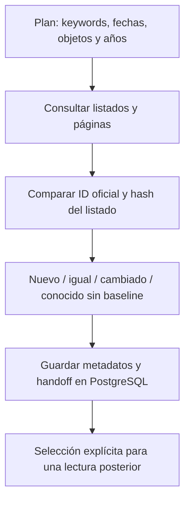
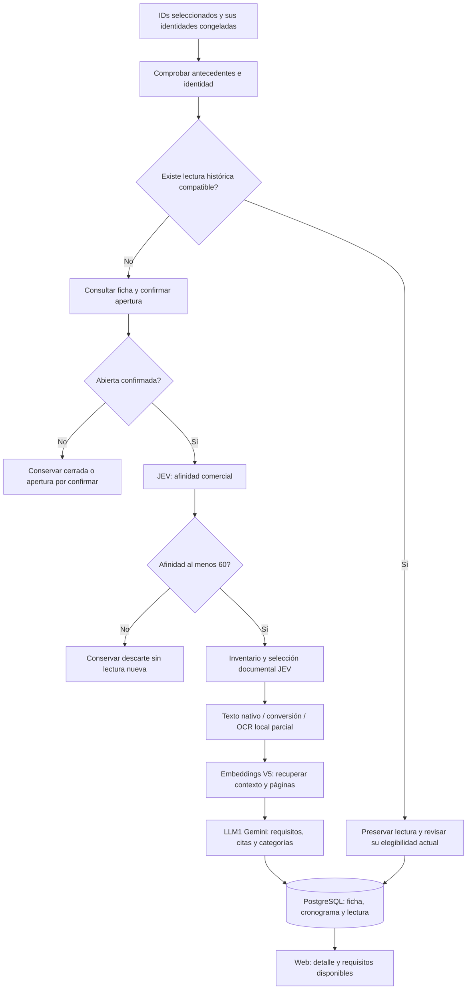
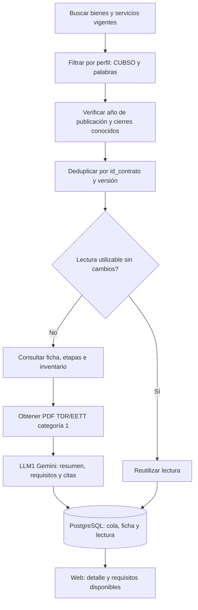
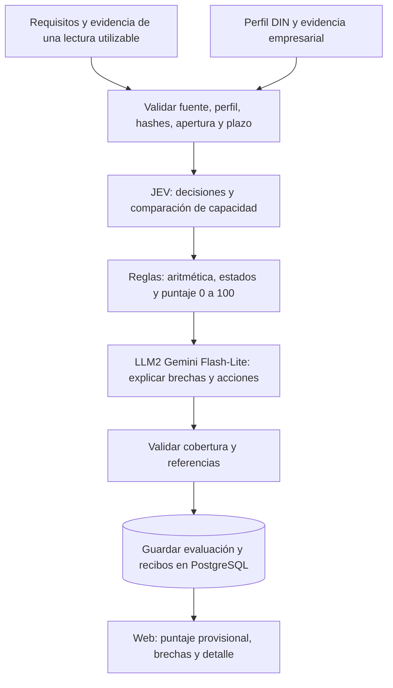

# BuenaPro: flujos completos y trabajo realizado

Guía de continuidad del **22/10/2026, hora de Lima**. Explica cómo entra una oportunidad, cómo se lee, cómo se compara con DIN, qué se publicó y qué sigue pendiente. Los resultados de lotes conservan sus fechas; no representan un censo actualizado de SEACE.

**LLM1 lee y estructura. JEV y reglas comparan y puntúan. LLM2 explica las brechas.** Los lectores y la evaluación empresarial son procesos separados. Una ficha publicada o una afinidad por título no equivalen a una lectura completa ni a capacidad acreditada.

## 1. Las piezas del sistema

| Pieza | Responsabilidad |
|---|---|
| Web Next.js/React/TypeScript | Oportunidades, filtros, detalle, perfil empresarial, cronograma y seguimiento |
| PostgreSQL | Fuente de verdad: identidades, fichas, etapas, documentos referenciados, lecturas, requisitos y evaluaciones |
| Redis | Trabajo pendiente del lector seleccionado PROD2; no sustituye los resultados persistidos |
| Lector PROD2 | Descubrir/seleccionar procedimientos del Buscador SEACE y leer documentos relevantes |
| Lector PROD6 | Descubrir contratos menores por perfil y leer PDF TDR/EETT admitidos |
| Evaluador DIN | Comparar requisitos utilizables con las capacidades y evidencias de DIN |
| Recibos y guardas | Evitar pagos repetidos, conservar respuestas y detener avances incompatibles |

PROD2 significa Buscador SEACE y PROD6 significa Contratos menores; no son dos ambientes de despliegue. Concursos SEACE/PROD4 salió de la navegación principal, conservando su código y datos históricos.

## 2. Flujo SEACE / PROD2

Hay dos herramientas distintas: **mapeo de metadatos** y **lectura seleccionada**. El primero encuentra IDs; no activa por sí solo la segunda.

### 2.1. Mapeo paralelo

La identidad es `id_convocatoria`, conservando `id_procedimiento`. Títulos iguales no fusionan convocatorias. El hash del listado no prueba que las bases, el estado o el cronograma sigan iguales.

El ejecutor permite hasta diez sesiones independientes dentro de un solo coordinador y con ritmo global. En el plan ejecutado se usó pacing de dos segundos; diez sesiones no equivalen a diez solicitudes por segundo. El mapeador no descarga documentos, llama modelos, utiliza Redis ni publica automáticamente fichas completas.

### 2.2. Lectura seleccionada por IDs

En la búsqueda ordinaria por keywords, el filtro JEV puede preceder al enriquecimiento de ficha; el diagrama representa la modalidad seleccionada por IDs, que comprueba apertura antes de nuevos modelos. Las decisiones y lecturas reutilizadas requieren identidad, hashes y política compatibles.

La búsqueda del ejecutor seleccionado termina antes de drenar su cola de lectura. Redis mantiene candidatos/reservas; PostgreSQL guarda los resultados y controles duraderos. El mapeador y el lector comparten exclusión de coordinador: no lanzar ambos coordinadores PROD2 al mismo tiempo.

JEV selecciona documentos relevantes, no necesariamente todo el expediente. La preparación convierte formatos admitidos y aplica OCR local parcial; OpenAI `text-embedding-3-small`, con 1536 dimensiones, ayuda a localizar fragmentos y sus páginas. **En V5 Gemini recibe el contexto textual recuperado, no el PDF completo.** Si no alcanza la cobertura, queda una revisión explícita; no se cambia a PDF completo u otro modelo por rutina.

### 2.3. Repetición automática

`prod2-ingest` envuelve al lector seleccionado, no al mapeador paralelo. Requiere alcance, ventana móvil, intervalo, primer ciclo y límites finitos explícitos. Espera después de cerrar un ciclo válido y comprueba fuente, cola, reporte y guardas antes de avanzar. Un cierre operativo puede conservar revisiones; no significa que todas las bases estén comprendidas.

Reutilizar una lectura puede evitar consultar de nuevo su detalle: repetir un barrido no garantiza refrescar todos los cronogramas históricos.

## 3. Flujo Contratos menores / PROD6

El descubrimiento usa una frase configurada o al menos dos términos de una misma línea comercial dentro del segmento correspondiente. **No usa el umbral JEV de 60 de PROD2.** Se descartan cierres conocidos vencidos; una fecha desconocida no acredita apertura.

El perfil de búsqueda y el perfil DIN evaluado después son configuraciones diferentes. No asumir que las líneas tecnológicas de un lector ya cubren todos los rubros DIN.

La cola dedicada vive en PostgreSQL, separada por fuente/perfil. Solo admite ficha, descarga, extracción y resumen. La ruta actual procesa PDF de categoría 1; otros anexos quedan inventariados. No convierte Word/ZIP/RAR como la ruta seleccionada PROD2 y no usa embeddings V5 en esta ingesta.

Los valores predeterminados permiten tres búsquedas, dos trabajos de entrada/salida y una lectura pagada simultánea, con límites por ciclo. Al terminar, espera 30 minutos antes del siguiente ciclo; no es un cron que arranque exactamente a las 00 y 30. El lector no encola automáticamente matching DIN ni notificaciones.

Una descarga puntual denegada puede quedar retenida para revisión mientras continúan otros documentos. Un bloqueo de búsqueda/ficha detiene el coordinador. Un envío pagado incierto bloquea nuevos pagos y conserva entradas y respuestas.

## 4. Flujo de evaluación DIN, posterior a la lectura

JEV toma decisiones de comparación y las reglas agregan la capacidad. Gemini `gemini-3.1-flash-lite` explica lo que falta y las acciones; no cambia la nota ni vuelve a leer PDFs. El usuario eligió Flash-Lite después de las restricciones de cuota de Gemma; nombres de archivos legacy no determinan el modelo real.

| Dimensión | Peso del flujo JEV/reglas |
|---|---:|
| Rubro | 20 |
| Experiencia relevante | 30 |
| Experiencia económica compatible | 30 |
| Profesionales/perfiles | 20 |

Los criterios no aplicables se reponderan. Moneda, período, participación, conformidad y deduplicación importan para calcular experiencia computable. Un importe global no acredita automáticamente experiencia compatible. Una brecha pequeña frente al mínimo se expresa con monto y acción, sin declararla cumplida.

RUC, RNP, CCI, declaraciones y formatos rutinarios van a un checklist y no restan capacidad. Las explicaciones deben distinguir falta de evidencia, incumplimiento y acción pendiente; no inventar que DIN tiene experiencia IA por haber realizado un suministro SCADA.

La biblioteca empresarial tuvo 43 documentos con texto persistido por archivo. El matching utiliza sus resúmenes, hechos y referencias estructuradas, sin releer los PDFs por cada oportunidad. **Por leer**, fallidas, vacías u obsoletas no están listas. Una lectura bajo revisión solo puede evaluarse provisionalmente cuando el ejecutor y plan lo admiten, conservando ese estado.

La unión comercial VEYON/DIN usada en algún descubrimiento no permite sumar capacidades de ambas empresas. El matching y la afinidad DIN individual comprueban tenant, perfil y hash propios.

## 5. Qué muestra el frontend

| Señal | Significado |
|---|---|
| Categoría | Tipo comercial de la compra; por título es preliminar |
| Afinidad | Encaje del objeto con las líneas de la empresa |
| Puntaje documental | Comparación de requisitos con evidencia empresarial |
| Brechas | Qué pide la entidad, qué acredita la empresa y qué falta |

Las seis categorías son Licencias y suscripciones, Desarrollo de software, IA y automatización, Industrial, Cloud e infraestructura y Soporte y mantenimiento. Pueden coexistir; no sumar sus conteos como oportunidades únicas. Una clasificación documental válida prevalece sobre la del título. Los ambiguos permanecen Por confirmar; Otros identifica compras fuera de estas categorías.

Los filtros se aplican antes de contar/paginar. En SEACE elegir categoría la aplica de inmediato y comparte su borrador con Buscar para no perderla en una carrera de navegación. En menores la aplicación permanece manual para combinar controles. Fuente, perfil, búsqueda, tipo y paginación deben conservar coherencia.

Los puntajes válidos del perfil se priorizan antes de paginar; Con puntaje no es afinidad por título. Un cero válido se muestra. Colores: menos de 30 rojo, de 30 a 80 inclusive amarillo y más de 80 verde. Una nota provisional conserva su advertencia aunque salga verde.

SEACE aparece primero y menores después. El detalle permite mostrar textos completos. El Gantt de SEACE toma las oportunidades guardadas del workspace y sus etapas oficiales mientras sus ofertas sigan abiertas; al vencer ofertas puede excluirlas aunque queden etapas posteriores. Guardar o actualizar la vista consulta datos persistidos, sin ejecutar scraping ni modelos. Menores conserva sus propias reglas de guardadas/afinidad/evaluación.

## 6. Trabajo realizado y resultados

### Mapeo del 20/10

Se cerraron 183 keywords —166 originales y 17 variantes— por 23 años y 2 objetos: **8.418 combinaciones y 1.736 IDs únicos**. Son metadatos; no son 1.736 lecturas ni oportunidades abiertas. No repetir el barrido para continuar documentos ya seleccionados.

### Lote original IA/industrial de 157

El recorrido terminó en 16 ciclos: 71 rechazos JEV, 57 cerrados, 17 aperturas sin confirmar, 8 revisiones de contexto, 1 selección documental pendiente y 3 históricos preservados. Cola propia drenada y reservas terminales. Ese recorrido no produjo LLM1 ni matches nuevos. Conservó 26 pendientes y 48 holds externos; 1.531 exclusiones por título no eran rechazos JEV.

### Continuidad posterior

Se publicaron los 157 metadatos: 144 nuevos y 13 preservados. Se completaron sus 157 afinidades comerciales individuales DIN; esto no equivale a 157 lecturas ni matches documentales.

De nueve recuperaciones documentales, dos lecturas quedaron persistidas con revisión —extracciones 550/551—, tres respuestas conocidas terminaron MAX_TOKENS y cuatro casos no se enviaron. No repetir los pagos. El LLM2 nuevo no se ejecutó: excedió guardas locales de entrada JEV —64.000 por solicitud/32.000 por pregunta— y explicación Flash-Lite —30.000—. No fue un nuevo diagnóstico de falta de créditos.

Se preparó y probó un particionador JEV puro, todavía sin integrar. Falta un plan completo de cobertura, transporte y recibos por parte y resolver también el contexto de explicación. Dividir JEV por sí solo no desbloquea el flujo.

### Clasificación y UI

El backfill inicial de 1.135 PROD2 clasificó 808, dejó 322 Por confirmar y 5 Otros, con 1.018 peticiones únicas. La proyección posterior de los 157 quedó en 61 con categorías, 21 Otros y 75 Por confirmar; 156por título y 1documental. La selección inicial 154industrial/3IA era léxica, no una verdad semántica final.

Los cortes se solapan: no sumarlos como inventarios distintos ni llamar 1.135al total actual después de publicaciones posteriores. Se corrigió y publicó el autoaplicado del filtro y la carrera con Buscar; se conservaron los controles manuales de menores.

### Documentación y diagramas del 21–22/10

Se consolidaron CONTEXTO.md, la guía de ambos lectores y dos PNG. La primera propuesta era ilustrativa; por petición del usuario se sustituyó por diagramas verticales de cajas/flechas. Las revisiones contrastaron el orden, las colas, LLM1, la evaluación separada y el papel explicativo de LLM2.

- [Diagrama SEACE](docs/architecture/20261022/seace-prod2-flujo.png).
- [Diagrama Contratos menores](docs/architecture/20261022/menores-prod6-flujo.png).
- [Prompts finales](docs/architecture/20261022/prompts.json).

## 7. Costos de los trabajos registrados

Son importes calculados desde uso y recibos, sin conciliación de factura ni infraestructura/OCR. No constituyen una cotización vigente para futuros lotes.

| Operación | USD conocidos |
|---|---:|
| Recorrido original IA/industrial, 55 JEV y 18 embeddings | 0.014445514 |
| Afinidad comercial DIN de 157 | 0.01006845 |
| Cinco LLM1 de la continuidad documental | 0.1578859 |
| Backfill inicial de títulos PROD2 | 0.040442136 |
| Completar categorías 157: 143 peticiones nuevas y 14reutilizadas | 0.005883528 nuevos |

No sumar nuevamente el costo de las respuestas reutilizadas. Tres evaluaciones técnicamente uncertain por parseo tienen respuestas y uso conocidos; son distintas de seis pagos históricos de otros lotes cuyo costo sigue desconocido. El agotamiento OpenAI del 13/10 tuvo recuperación verificada tras recarga; no presumir que sigue siendo el bloqueo actual.

## 8. Estado operativo y código

En la comprobación Docker de esta entrega, la web conserva la imagen `buenapro-web:category-search-f2d5538` y está running. Los contenedores PROD2/PROD6 siguen created, detenidos, con imágenes `service-2b1b0d6` y `pg-guard-5950706`. No se volvieron a consultar las fuentes ni los modelos.

Los diagnósticos de acceso anteriores conservaron 403 desde la VM para ambas fuentes y desde Mac para menores; PROD2 sí tuvo mapeo manual exitoso desde Mac. Eso no acredita acceso VM ni justifica reintentar automáticamente. PROD2 necesita además alcance, ventana y límites privados activos.

El checkout local de continuidad usa `codex/prod2-parallel-discovery-prep`. En la VM se encontró otro checkout en `main`, con una modificación existente de configuración; se conserva. Las imágenes en ejecución y los HEAD de los checkouts son identidades diferentes. **Subir este documento no actualiza runtime, despliega web ni activa lectores.**

| Entrada de código | Responsabilidad |
|---|---|
| `scripts/run_prod2_parallel_discovery.py` | Mapeo paralelo |
| `scripts/run_prod2_selected.py` | Lectura seleccionada |
| `workers/seace/src/buenapro_worker/prod2/service.py` | Ciclos PROD2 |
| `workers/seace/src/buenapro_worker/jobs/poll_prod6_profile.py` | Descubrimiento de menores |
| `workers/seace/src/buenapro_worker/prod6/runtime.py` | Coordinación y cola dedicada PROD6 |
| `scripts/run_dinaut_sector_matches.py` | Matching DIN posterior |
| `workers/seace/src/buenapro_worker/matching/jev_recommendations.py` | Comparación y explicación |
| `apps/web/server/services/commercialClassification.ts` | Clasificación consultable |
| `apps/web/features/` | Frontend por dominio |

## 9. Reglas para continuar sin perder trabajo

Conservar identidades, manifiestos, hashes, reservas y recibos. No reabrir resultados históricos ni cambiar de carpeta para repetir un pago. Una salida2 puede cerrar operativamente con revisiones si su gate lo admite; nunca interpretarla por sí sola como permiso para reiniciar.

El tratamiento de errores depende del ejecutor: un intento incierto no se repite; algunas guardas detienen el lote y otras impiden el siguiente ciclo. No borrar estados/colas para superar el bloqueo. La recuperación exige diagnóstico y evidencia compatible.

Los originales nuevos de SEACE son temporales de análisis. Persistir resultados, UUID, hashes, referencias oficiales y recibos, sin originales nuevos en R2 ni tickets temporales persistidos. Retirar solo temporales propios cerrados después de verificar persistencia; conservar documentos/OCR de pendientes, revisiones e inciertos.

Trabajar localmente, validar, actualizar tasks/, commit/push y publicar desde Git. Los cambios UI requieren arquitectura y QA visual Glass. Un despliegue web no autoriza migraciones, nuevas inferencias, activar colas ni reiniciar lectores.

## 10. Pendientes reales

1. Recuperar acceso legítimo de cada lector desde su host, completar configuración y comprobar un ciclo completo y su repetición con un único coordinador por fuente.
2. Resolver explícitamente las lecturas y vigencia pendientes, conservando las respuestas truncadas y los casos no enviados. No equiparar descartados/cerrados con lecturas por ejecutar.
3. Integrar un plan de partición JEV y explicación extensa con cobertura, límites, reservas y recibos por parte antes de pagar.
4. Mantener ambiguos y QA semántica pendientes: compatibilidad de objetos, montos, períodos, experiencia y profesionales.
5. Mejorar frescura/rendimiento con un alcance separado; no afirmar que reutilizar lecturas refresca todos los cronogramas.

El seguimiento del lote original fue pausado tras el cierre operativo. Este documento no autoriza nuevos lotes, sondeos, compras, reintentos o cambios de límites.

## 11. Entrega en la VM y fuentes

La entrega documental usa una carpeta independiente: `/home/ubuntu/buenapro-docs/actual/`. Sus archivos se obtienen del commit subido a Git, con manifiesto y comparación SHA-256. Se conserva el checkout de producción y su configuración; no se construyen imágenes ni reinician contenedores.

Este Markdown, los dos PNG y sus prompts forman el paquete legible en la VM. Los documentos técnicos completos se consultan en el repositorio, con esta base de referencias inmutable:

- [Contexto general](https://github.com/VEYON-DEV/BUENAPRO/blob/0cbe9a7/CONTEXTO.md).
- [Guía técnica de lectores](https://github.com/VEYON-DEV/BUENAPRO/blob/0cbe9a7/docs/guia-lectores-seace-menores.md).
- [Mapeo completo](https://github.com/VEYON-DEV/BUENAPRO/blob/0cbe9a7/docs/prod2-parallel-discovery-execution-20261020.json).
- [Cierre del lote original](https://github.com/VEYON-DEV/BUENAPRO/blob/0cbe9a7/docs/ia-industrial-execution-20261020.md).
- [Continuidad documental posterior](https://github.com/VEYON-DEV/BUENAPRO/blob/0cbe9a7/docs/prod2-sector-followup-20261020.md).
- [Categorías y corrección publicada](https://github.com/VEYON-DEV/BUENAPRO/blob/0cbe9a7/docs/prod2-category-filter-fix-20261020.md).
- [Operación de matching](https://github.com/VEYON-DEV/BUENAPRO/blob/0cbe9a7/docs/matching-three-dot-batch.md).
- [Flujo de publicación](https://github.com/VEYON-DEV/BUENAPRO/blob/0cbe9a7/docs/deployment-workflow.md).

No contiene secretos ni documentos empresariales. No se generaron descargas de fuentes, OCR o inferencias en esta entrega; los materiales pendientes previos permanecen conservados. La limpieza y los hashes de entrega se registran en el recibo documental.
