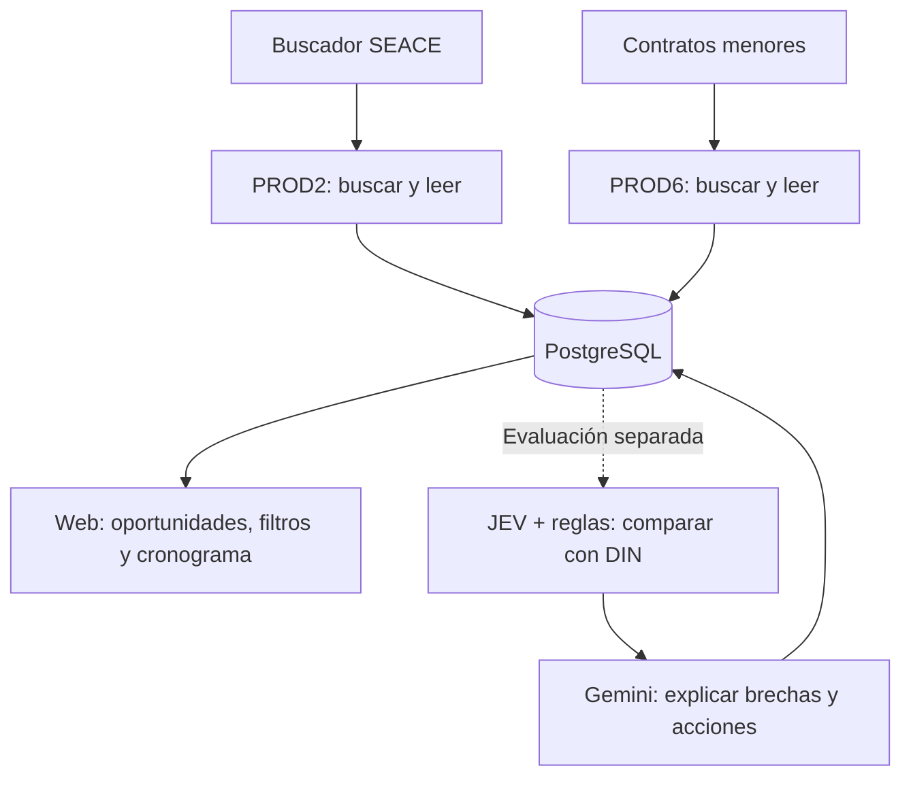

# Cómo funcionan Buscador SEACE y Contratos menores

BuenaPro tiene **dos lectores independientes**: PROD2 para Buscador SEACE y PROD6 para Contratos menores. Cada uno busca oportunidades, prepara sus documentos y guarda la información en PostgreSQL. La web consulta esa base. Después, un proceso separado puede comparar lo leído con DIN y explicar sus brechas.

**El código permite repetir ciclos automáticamente, pero los dos servicios de producción están detenidos.** La comprobación del **21/10/2026 a las 22:10, hora de Lima**, encontró ambos contenedores en estado `created`, sin ejecución. Esta guía explica lo implementado y distingue lo que todavía requiere activación.

## 1. El mapa completo

Que aparezcan oportunidades en la web significa que hay datos guardados. **No demuestra que un lector esté encendido.** Guardar una oportunidad para verla en el cronograma tampoco inicia una lectura ni una evaluación pagada.

## 2. Buscador SEACE: PROD2

Aquí hay dos herramientas distintas.

### Mapeo: encontrar y comparar IDs

El mapeador paralelo consulta palabras clave, fechas, años y objetos definidos en un plan. Compara el ID oficial y el hash del listado: identifica registros nuevos, iguales, cambiados o conocidos sin una versión comparable.

Puede usar hasta diez sesiones dentro de un único coordinador, respetando el ritmo global de consultas. Produce un inventario para decidir qué leer. **El mapeo por sí solo no descarga bases, llama modelos ni publica fichas completas.**

El barrido del 20/10 cubrió las 8.418 combinaciones planificadas y conservó 1.736 IDs únicos. Esa cifra no equivale a 1.736 lecturas ni a 1.736 oportunidades abiertas. El [informe del mapeo](prod2-parallel-discovery-execution-20261020.json) conserva el resultado.

### Lectura: entender las oportunidades seleccionadas

El lector seleccionado recibe un alcance por palabras clave o una selección explícita de IDs. En la búsqueda ordinaria, JEV precede al enriquecimiento de ficha. Con IDs seleccionados, primero consulta ficha y confirma apertura antes de nuevos modelos; una lectura preservada por ID puede omitir JEV. Las etapas son:

1. **Buscar y comprobar antecedentes.** Completa el alcance de búsqueda y prepara los candidatos. Reutiliza lecturas y decisiones compatibles para evitar pagar otra vez por lo mismo.
2. **Filtrar con JEV.** Compara la oportunidad con el contexto comercial configurado. Los lotes seleccionados actuales usan un umbral de 60; ese filtro no es todavía el puntaje documental de DIN.
3. **Completar ficha, cronograma y archivos.** Enriquece los candidatos aceptados; reutiliza la consulta de ficha si ya se hizo en el paso anterior.
4. **Elegir los documentos relevantes.** Otra decisión JEV selecciona bases, TDR, EETT o anexos pertinentes.
5. **Preparar el texto.** Extrae texto, convierte formatos admitidos y aplica OCR local parcial cuando corresponde. Los embeddings V5 ayudan a recuperar los fragmentos relevantes con sus páginas.
6. **Leer con Gemini, llamado LLM1.** Recibe el texto recuperado, sin enviarle el PDF completo en esta modalidad V5. Estructura requisitos, montos, experiencia, profesionales y evidencia. Si el contexto resulta insuficiente, conserva una revisión pendiente.
7. **Guardar y comprobar.** Persiste resultados, identidad, cronograma, referencias, hashes y recibos; solo retira temporales cerrados cuando corresponde.

La búsqueda y la lectura no son una cadena completamente simultánea: el ejecutor seleccionado termina primero su búsqueda y después procesa la cola de candidatos. Redis mantiene esa cola; PostgreSQL conserva los resultados y controles duraderos.

### Cómo se repite automáticamente

El servicio `prod2-ingest` envuelve al lector seleccionado. Al cerrar un ciclo completo, espera el intervalo configurado y prepara otro con su ventana móvil de publicación. **No ejecuta automáticamente el mapeador paralelo.**

No tiene una frecuencia fija predeterminada: requiere alcance, intervalo, ventana, máximo de ciclos y límites explícitos de solicitudes. Solo avanza si la búsqueda terminó, la cola se drenó y no existe un bloqueo de acceso, integridad o pago incierto. Las revisiones documentales pueden conservarse sin impedir un cierre operativo válido.

Conservar una lectura anterior puede evitar volver a consultar su detalle. Por eso, repetir el barrido **no garantiza refrescar todos los cronogramas históricos**.

## 3. Contratos menores: PROD6

PROD6 consulta la API de menores con las líneas comerciales del perfil configurado. Su selección inicial usa **reglas de CUBSO y palabras**, sin el filtro JEV de 60 de PROD2.

1. **Buscar.** Consulta bienes y servicios en estado nativo vigente y comprueba el año de publicación.
2. **Filtrar.** Exige el segmento configurado y una frase o al menos dos términos de una misma línea comercial. Descarta cierres conocidos ya vencidos; una fecha desconocida permanece sin confirmar.
3. **Comparar IDs y versiones.** Deduplica por `id_contrato`. Una extracción vigente y utilizable puede reutilizarse.
4. **Consultar ficha y archivos.** Guarda detalle, etapas e inventario documental.
5. **Leer el documento admitido con Gemini LLM1.** La ruta actual extrae PDF de categoría 1, correspondiente a TDR/EETT. Los demás archivos pueden quedar listados: esta ruta no convierte Word ni abre ZIP/RAR como PROD2 seleccionado.
6. **Derivar y guardar.** Construye resumen y requisitos consultables por la web.

El servicio `prod6-ingest` espera **30 minutos después de terminar cada ciclo**, por defecto. No significa que arranque exactamente a las 00 y 30 de cada hora. Sus valores predeterminados permiten tres búsquedas simultáneas, dos trabajos de entrada/salida y una lectura pagada a la vez, con límites por ciclo.

La cola vive en PostgreSQL, separada por fuente y perfil. El lector dedicado solo admite trabajos de ficha, descarga, extracción y resumen: **no activa por sí mismo la evaluación DIN ni las notificaciones**. El perfil usado para descubrir oportunidades y la empresa evaluada después son configuraciones diferentes.

## 4. Qué comparten y qué controlan por separado

| Aspecto | PROD2 | PROD6 |
|---|---|---|
| Fuente | Buscador SEACE | Contratos menores |
| Identidad oficial | Convocatoria, conservando procedimiento | Contrato menor |
| Selección inicial del lector | Alcance configurado y JEV comercial | Perfil, CUBSO y palabras |
| Cola del lector | Redis | PostgreSQL |
| Resultado duradero | PostgreSQL | PostgreSQL |
| Repetición | Intervalo y ciclos explícitos | Espera predeterminada de 30 minutos |
| Coordinación | Un coordinador PROD2; mapeador y lector comparten exclusión | Un coordinador PROD6 |
| Reinicio Docker actual | Desactivado | Desactivado |

Pueden trabajar independientemente y convivir. Comparten infraestructura y proveedores, de modo que una caída de PostgreSQL puede afectar a ambos. Un bloqueo propio de una fuente no obliga a apagar la otra.

Los documentos nuevos se usan para análisis temporal. Se conservan datos, hashes, referencias oficiales y recibos; **estos lectores no crean nuevos originales permanentes en R2**. Los originales siguen en SEACE. Las entradas pendientes, revisiones y pagos inciertos se conservan para su recuperación segura.

## 5. Categoría, afinidad y puntaje son cosas distintas

| Señal | Qué responde | Información utilizada |
|---|---|---|
| Categoría | ¿Es licencia, desarrollo, industrial u otro tipo? | Título para clasificación preliminar; evidencia documental cuando existe |
| Afinidad comercial | ¿Se parece al rubro de DIN? | Título y líneas comerciales |
| Puntaje documental DIN | ¿Qué capacidad acredita DIN frente a estos requisitos? | Lectura utilizable, experiencia, montos y profesionales de la empresa |
| Recomendaciones | ¿Qué falta y qué acción concreta tomar? | Resultado de la comparación y evidencia disponible |

En el flujo DIN JEV/reglas, las dimensiones de capacidad son rubro, experiencia, experiencia económica y perfiles profesionales. Gemini Flash-Lite explica las brechas. RUC, RNP y formularios rutinarios no se usan para bajar ese puntaje. Una categoría o afinidad por título no sustituye la lectura de requisitos; **«Por leer» no está listo para esta evaluación**.

Los embeddings de PROD2 usan OpenAI `text-embedding-3-small`: sirven para localizar texto, no para redactar recomendaciones. JEV filtra o compara según la etapa; Gemini lee y estructura, o explica en el flujo posterior.

## 6. Estado actual y qué falta para llamarlo automático

La [comprobación de contenedores del 21/10](evidence/readers-architecture-status-20261021.json) fue de solo lectura, sin consultar SEACE ni modelos:

| Servicio preparado | Estado comprobado | Imagen |
|---|---|---|
| `prod2-ingest` | `created`, detenido | `buenapro-worker-prod2:service-2b1b0d6` |
| `prod6-ingest` | `created`, detenido | `buenapro-worker-prod6:pg-guard-5950706` |

El [último consolidado de activación](readers-consolidation-20261019.json) mantiene pendiente resolver el acceso legítimo desde el servidor y completar la configuración activa de PROD2. Los diagnósticos de acceso guardados son anteriores a esta comprobación; hoy no se repitieron. El mapeo manual exitoso desde Mac no acredita acceso desde la VM.

Para activar hay que comprobar acceso real a búsqueda, ficha y documentos, definir el alcance y presupuesto de cada lector, conciliar sus entradas pendientes y verificar un ciclo completo con un único coordinador por fuente. Después debe comprobarse la espera y el siguiente ciclo.

Una llamada de pago incierto queda bloqueada y no se repite. Según el ejecutor, las guardas detienen el lote o impiden el siguiente ciclo. En PROD6, una descarga denegada retiene solo ese documento para revisión y permite continuar con otros; un bloqueo de búsqueda o ficha detiene el coordinador. La recuperación exige un diagnóstico compatible con las entradas y recibos conservados.

El checkout local contiene mejoras posteriores a las imágenes preparadas. **Publicar la web no actualiza los lectores**: cada imagen necesita su propio commit, construcción y validación. Tampoco iniciar los lectores activa automáticamente el matching de DIN.

## 7. Dónde está cada pieza

| Pieza | Archivo |
|---|---|
| Mapeador paralelo PROD2 | [run_prod2_parallel_discovery.py](../scripts/run_prod2_parallel_discovery.py) |
| Lector seleccionado PROD2 | [run_prod2_selected.py](../scripts/run_prod2_selected.py) |
| Ciclos automáticos PROD2 | [prod2/service.py](../workers/seace/src/buenapro_worker/prod2/service.py) |
| Servicio Docker PROD2 | [prod2.compose.yml](../infra/docker/prod2.compose.yml) |
| Descubrimiento de menores | [poll_prod6_profile.py](../workers/seace/src/buenapro_worker/jobs/poll_prod6_profile.py) |
| Ciclos y cola dedicada PROD6 | [prod6/runtime.py](../workers/seace/src/buenapro_worker/prod6/runtime.py) |
| Servicio Docker PROD6 | [prod6.compose.yml](../infra/docker/prod6.compose.yml) |
| Evaluación DIN por separado | [run_dinaut_sector_matches.py](../scripts/run_dinaut_sector_matches.py) |
| Comparación y recomendaciones | [matching/jev_recommendations.py](../workers/seace/src/buenapro_worker/matching/jev_recommendations.py) |

Esta tarea solo documentó y verificó la arquitectura: no activó servicios, cambió colas ni envió solicitudes pagadas. No generó descargas temporales; se liberaron 0 bytes y se conservaron las entradas pendientes existentes.
