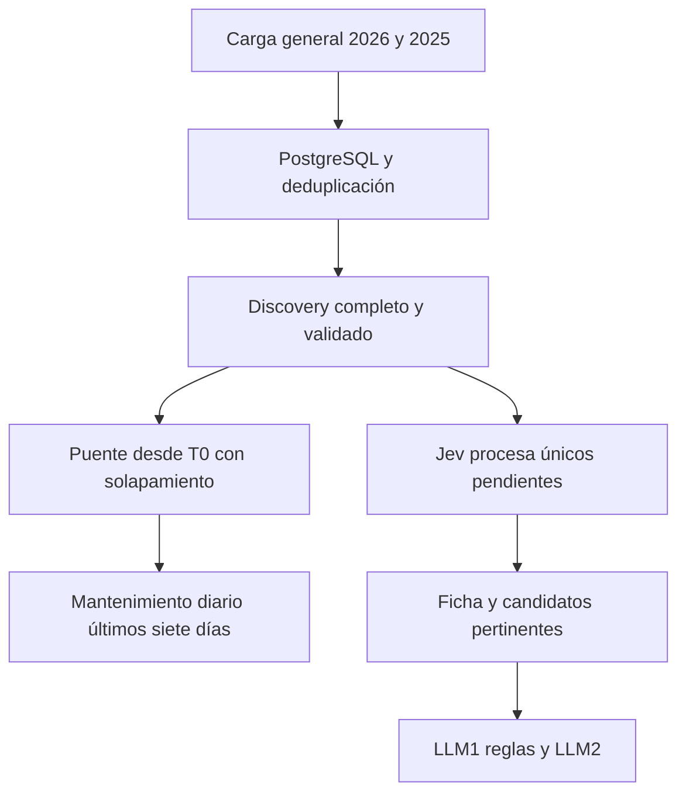

# Plan de barrido PROD2 y persistencia del convenio

**Actualización06/10/2026:** el alcance vigente es [la carga de seis meses con Jev y cronogramas](prod2-six-months-ingestion.md), con [configuración v4](sources/prod2-convenio-keywords.v4.json). Las fechas de publicación son independientes del año de convocatoria; se leen todos los años nativos y se omiten solo ceros amplios comprobados. PDF/Gemini quedan para una segunda ejecución. El ejecutor y su validación se documentan en ese archivo.

## Plan anterior v3: referencia histórica

El texto siguiente describe la propuesta del05/10/2026, sustituida por el alcance de seis meses. Sus664 combinaciones y carga2026/2025 no representan la nueva corrida ni un resultado ejecutado.

El alcance es Procedimientos de Selección de PROD2, bienes y servicios, con un perfil comercial conjunto VEYON y Dinaut. Primero se completa una carga general de los años y keywords definidos; después se recupera lo publicado durante esa carga y se activa el mantenimiento diario de los últimos siete días. Discovery se guarda antes de Jev y no espera lectura documental. Es una propuesta de implementación; no crea un scraper o jobs productivos.

## Keywords y alcance

El barrido incluye todas las líneas activas de Dinaut, incluidas las ocho industriales, y las tres líneas del perfil principal de VEYON. Dinaut tiene 146 señales únicas y VEYON 36; comparten 16. La unión normalizada contiene 166 keywords: 73 digitales y 93 industriales. Se unifican `keywords`, `keyword_phrases` y `keyword_terms` por mayúsculas, acentos y espacios. Las copias históricas de VEYON no se mezclan.

Cada keyword se consulta en Bien y Servicio, incluidas las frases específicas y los términos cortos. Para la carga general propuesta de 2026 y 2025, el convenio completo requiere 664 combinaciones base: 166 keywords × dos objetos × dos años, más páginas y particiones. Después de esa carga y su puente, una vuelta diaria requiere 332 combinaciones para el convenio o 292 para Dinaut sola. Una consulta base no equivale a un request.

La [configuración actual de propuesta](sources/prod2-convenio-keywords.v3.json) conserva el inventario por empresa y línea, todas las keywords y los bloques de rotación. Las versiones 1 y 2 quedan como referencias históricas. Resolver valores nativos de Bien y Servicio desde el formulario PROD2; no reutilizar códigos PROD4/PROD6.

IA, API o APP pueden recuperar subcadenas ajenas. Se incluyen en el recorrido solicitado, midiendo ruido y límites. La clasificación exige palabras completas y contexto: una coincidencia del buscador no demuestra relevancia. No retirar una keyword ni sustituir varias frases por una palabra amplia sin registrar el cambio y verificar su cobertura.

## Rotación durante el mantenimiento

| Familia | Keywords | Consultas base por vuelta | Meta |
|---|---:|---:|---|
| Digitales prioritarias | 14 | 28 | Al menos una vuelta en 24 horas |
| Digitales complementarias | 28 | 56 | Al menos una vuelta en 24 horas |
| Exploración digital | 7 | 14 | Al menos una vuelta en 24 horas |
| Digitales adicionales | 24 | 48 | Al menos una vuelta en 24 horas |
| Industriales | 93 | 186 | Al menos una vuelta en 24 horas |
| Total | 166 | 332 | Todas las páginas y subventanas completas |

Distribuir la cuota en 24 bloques horarios: 22 bloques de siete keywords y dos de seis. Cada keyword se consulta en ambos objetos, dando 12–14 consultas base por bloque. Intercalar familias para que industria y digital reciban resultados durante todo el día. Los bloques son una distribución de trabajo, no capacidad comprobada del portal.

Usar una sesión JSF con operaciones secuenciales. Guardar fecha de la última terminación completa por keyword, objeto y ventana. El planificador prioriza pendientes y el plazo más antiguo; no crea otra copia si un trabajo sigue activo. Si una consulta necesita muchas páginas, puede ceder el turno tras guardar una página y reanudar con sus filtros y checkpoint verificados. No marcarla completa hasta terminar todas sus particiones.

Reservar capacidad separada para refrescar fichas abiertas y para la reconciliación diaria sin keyword. El trabajo histórico semanal usa el margen restante. Las 14 keywords prioritarias pueden tener una pasada adicional cada dos horas sobre las últimas 72 horas, siempre que no desplace la cuota diaria, las fichas o la reconciliación.

La meta de 24 horas requiere medir tiempo y páginas. Contar filas duplicadas no consume tokens, pero sí tiempo de consultas. Si queda una keyword/objeto sin terminar, registrar atraso, conservar su avance y reducir extras; no declarar éxito ni descartar páginas para cerrar la jornada.

## Carga general

### Arranque desde la laptop y traslado del colector

La propuesta operativa es ejecutar el colector HTTP en la laptop y guardar los registros en el PostgreSQL actual mediante túnel SSH temporal ligado a `127.0.0.1`. La [prueba HTTP del 05/10/2026](sources/prod2-http-flow-20261005.md) verificó SOFTWARE/Bien y Servicio, apertura de ficha desde una fila y descarga de sus cuatro archivos, sin navegador. El [ejecutor local PROD4](sources/prod4-local-worker.md) conserva como referencia el patrón de túnel/persistencia; PROD4 está retirado. Faltan paginación general, persistencia idempotente y reanudación; el caso acotado no acredita el barrido completo.

Antes de la carga general, implementar y validar un lote pequeño y repetible: consultar una keyword en Bien y Servicio, recorrer todas las páginas de una ventana acotada, verificar identidad oficial, guardar discovery y checkpoint juntos y repetirlo. La segunda pasada conserva observaciones y no duplica procedimientos, reservas ni tokens. Este piloto no libera Jev/LLM ni descarga documentos masivamente. Los cambios de esquema requeridos se preparan de forma compatible y se validan antes de escribir el lote.

Después del piloto, ejecutar desde la laptop el manifest de carga general y el puente ya definidos. La laptop debe permanecer encendida y conectada; ante suspensión, corte de red o pérdida del túnel, conservar el último commit y retomar sin marcar páginas incompletas como terminadas. Si se conserva un spool local privado, importar sus páginas idempotentemente y confirmarlas en PostgreSQL antes de descartarlo. Los PDFs locales y URLs con credenciales temporales no son el estado duradero del proceso.

Cuando una VM nueva complete una prueba positiva del mismo flujo, detener el colector local en un límite de página confirmado, dejar ninguna captura local pendiente de persistir y liberar o recuperar el lease. Arrancar el colector de la VM con el mismo manifest, configuración y frontera; abrir una sesión HTTP/JSF nueva y reconciliar la página/frontera de reanudación. Los checkpoints describen filtros, particiones e IDs observados, no una sesión JSF portable. Nunca ejecutar los dos colectores con la misma sesión o partición al mismo tiempo; validar lease/heartbeat/recuperación antes del traslado.

PostgreSQL permanece como fuente de verdad: cambiar la máquina que consulta SEACE no exige migrar la BD ni repetir análisis de inputs idénticos. Si también se decide trasladar PostgreSQL, tratarlo como una migración separada con respaldo, restauración comprobada, versiones compatibles y corte controlado; no restaurar una copia antigua de la laptop sobre datos activos. En este plan no se creó una segunda BD ni se ejecutaron carga, modelos o migraciones. [Capacidad propuesta para el colector](prod2-deployment-sizing.md).

Proponer como alcance inicial 2026 hasta el corte de inicio T0 y todo 2025. Esta carga incluye todas las keywords y los dos objetos del convenio. Los años anteriores se incorporan después mediante un backfill configurable; no se declaran cubiertos por esta carga inicial. Una carga general del convenio no es un censo nacional sin keywords.

Al iniciar, persistir un manifest con identificador de corrida, configuración y keywords congeladas, años, objetos, rangos nativos de publicación y T0. El formulario trabaja con sus fechas disponibles: fijarlas y registrar su relación con T0; esto no crea un snapshot transaccional del portal. Si la ejecución se reinicia, reanudar ese mismo manifest.

Recorrer 2026 empezando por software, licencias y control industrial; continuar las demás keywords y luego 2025. Para cada keyword/año: consultar Bien, recorrer sus páginas, consultar Servicio y recorrer sus páginas. Ante truncamiento, subdividir fechas y completar todas las subventanas. Si una partición se divide, el padre queda completo solo cuando lo estén todos sus hijos. Si el límite persiste en una ventana mínima, usar otra dimensión exhaustiva verificada o conservarla pendiente.

Guardar primero en PostgreSQL el ID oficial, convocatoria, descripción/hash, objeto, comprador, publicación, URL y observaciones de consulta. Cada página se deduplica y se confirma junto con su checkpoint. La coincidencia de un título no fusiona procedimientos diferentes. Conservar metadatos mínimos de todos los IDs dentro del alcance, incluso si después Jev los rechaza.

Durante esta etapa se reservan las evaluaciones pendientes sin ejecutar Jev. No descargar bases ni lanzar LLM1/LLM2 masivamente. El objetivo es construir el inventario único y conocer su cobertura; los modelos se liberan después por colas independientes.

## Criterio de finalización de la carga

Marcar `bootstrap_discovery_complete` solamente cuando:

- Las 664 combinaciones iniciales tengan todas sus páginas y subparticiones completas.
- Todas las filas recuperadas estén persistidas con identidad verificable y sus observaciones de origen.
- Los checkpoints estén confirmados después de las escrituras.
- No queden particiones pendientes, fallidas o posiblemente truncadas.
- El reporte indique rango, combinaciones cubiertas, filas observadas, IDs únicos, duplicados y errores.

No basta HTTP 200, una primera página o un contador de 499 filas. Una consulta vacía exige comprobar que sea un resultado válido. Los LLM y los PDFs pendientes no forman parte de este gate: pueden avanzar después sin detener el cambio de modo.

## Puente entre la carga y el mantenimiento

La fuente sigue publicando mientras se carga el histórico. Al terminar discovery, crear un recorrido desde T0 menos siete días hasta un corte fijo Tc, con las 166 keywords en ambos objetos. Esa ventana puede superar siete días. Si la carga tarda 15 días, limitarse al último tramo de siete omitiría publicaciones de los primeros días de carga.

Completar todas sus páginas y guardar H, el extremo final cubierto por todas las combinaciones. Si el puente también tarda, retomar desde la frontera H con solapamiento y ampliar hasta el siguiente corte fijo. No sustituir el rango pendiente por la fecha actual ni exigir alcanzar literalmente el instante presente mientras llegan publicaciones.

Al confirmar el puente, guardar en una sola transacción la frontera H, el modo `incremental_active` y el próximo trabajo u outbox de seguimiento. Así, un fallo antes del commit retoma el puente; un fallo después conserva un trabajo duradero para continuar. La recuperación de leases y la deduplicación de ejecución siguen siendo necesarias.

Si H quedó fuera de los últimos siete días, el primer trabajo de mantenimiento recupera desde H menos siete días hasta su corte fijo. La ventana estricta de los últimos siete días comienza cuando ese atraso está cubierto. Liberar Jev desde el fin de discovery, en paralelo al puente; no esperar sus scores o documentos para comenzar el mantenimiento.

## Mantenimiento y seguimiento

1. Cada día: recorrer las 166 keywords en Bien y Servicio sobre los últimos siete días de publicación, fijando los extremos por recorrido. Si cruza un año, cubrir ambos años. Ante una parada larga, ampliar desde la frontera pendiente; no perder jornadas al retomar.
2. Paginar y subdividir cualquier ventana sospechosa de truncamiento; las pendientes siguen pendientes hasta completar su contenido.
3. Reconciliar diariamente las publicaciones de Bien y Servicio de los últimos siete días sin keyword. Incorporar los IDs al mismo registro y filtro, sin descargar todos sus documentos.
4. Reservar presupuesto para actualizar fichas abiertas conocidas cada cuatro horas, con prioridad cerca de cierre. Esto no requiere Jev y no descubre por sí solo reaperturas de IDs desconocidos o cerrados.
5. Recorrer ampliamente 2026 y 2025 con objetivo semanal, guardando avance entre jornadas. Detecta cambios fuera de la ventana reciente; no garantiza captar años aún pendientes.

Una vuelta diaria completa significa todas las keywords, objetos, páginas y particiones de su ventana. La vigencia se comprueba por estado y cronograma oficial, no por antigüedad del registro ni por haber aparecido en una búsqueda.

La fecha de término de cada ventana se congela durante el recorrido y se revisan fronteras después, porque publicaciones tardías pueden desplazar páginas. Conservar IDs y evidencias de páginas observadas; un número de página aislado no prueba integridad. Si una llamada o bloqueo falla, retomar con la sesión normal y reconciliar la frontera, sin evadir controles.

## PostgreSQL antes de Jev

Usar una base PostgreSQL con capas de datos; Redis no es necesario para este flujo. Reutilizar identidad canónica y cola existentes y armonizar tablas nuevas con el modelo actual.

| Capa propuesta | Qué conserva | Cuándo se escribe |
|---|---|---|
| Discovery mínimo | Identidad oficial, convocatoria, objeto, descripción/hash, fuente, primera/última aparición y situación del filtro | Siempre que la fila sea válida y dentro del alcance |
| Observaciones de consultas | Keyword, ventana, página y relación con el procedimiento encontrado | También para un duplicado |
| Evaluaciones Jev | Versión de inputs/perfil/rúbrica/modelo, estado, score, confianza, suficiencia y usage | Reserva antes del request y resultado después |
| Catálogo operativo | Candidatos aceptados o pendientes relevantes, ficha, cronograma, documentos y análisis posteriores | Después del filtro; puede ser una vista de los registros, sin copiar toda la fila |
| Checkpoints | Última página/partición confirmada, avance y fallos | Después de guardar la página completa |

Los rechazados conservan metadatos mínimos y su decisión. No aparecen como recomendaciones ni se les descargan documentos por defecto. Borrarlos obligaría a evaluarlos de nuevo cuando otra keyword los encuentre. El catálogo puede filtrar un campo de estado; no hace falta mover registros entre bases.

## Enriquecimiento después de Jev

Crear una etapa independiente de ficha para candidatos aceptados y casos ambiguos que necesiten más contexto. Se ejecuta desde la sesión normal PROD2; si una referencia UUID pierde contexto, regenerar la acción desde el resultado oficial. Una URL opaca no es la identidad permanente del procedimiento.

Primero guardar en PostgreSQL los datos estructurados de ficha sin LLM: snapshot sanitizado, fecha de lectura y versiones/hash del parser; convocatoria, entidad, cuantía/moneda, normativa y modalidad cuando consten, cronograma completo y canales, ítems/estados/CUBSO disponibles, e inventario de documentos con etapa, etiqueta, publicación, nombre/UUID observado y referencia oficial. Cada enlace conserva método de acceso, dependencia de sesión y última verificación. No persistir cookies, ViewState o tickets como enlaces públicos. Campos faltantes permanecen desconocidos. Conservar por separado publicación, apertura de registro, apertura/cierre de propuestas y estado: una publicación de hoy puede corresponder a un procedimiento cuya participación ya terminó.

Separar la etapa/fechas de Buena Pro, los documentos listados para ella y el resultado oficial adjudicado. Ganador, monto adjudicado y fecha efectiva requieren evidencia explícita por convocatoria/ítem; no se infieren de una fecha del cronograma ni de un nombre de archivo. Esta captura de ficha precede a LLM1/LLM2 y no gasta tokens. Un cambio exclusivo de fecha/estado actualiza vigencia y snapshot, sin volver a llamar Jev o analizar el mismo PDF.

Comprobar vigencia y tipo de participante antes de encolar documentos automáticamente. Una consultoría individual puede tener afinidad tecnológica sin ser postulable por una empresa. Discrepancias quedan pendientes de conciliación; no se resuelven solo con el score Jev.

Seleccionar bases integradas/TDR/EETT vigentes y anexos pertinentes; descargar, verificar firma/MIME/tamaño, detectar clase por contenido y guardar SHA-256 con procedencia. SEACE conserva el original; PostgreSQL guarda las referencias y resultados. La prueba del TDR confirmó el servicio documental `alfprod/.../service/osce/downloadDoc` sin cookies desde el Mac: UUID observado → resolver oficial → URL entregada con ticket → PDF. Conservar el resolver/UUID, regenerar la credencial y no exponer el ticket en enlaces públicos. El intento desde la VM rechazó los cuatro resolvers con 403; acceso exitoso y descarga de los demás documentos siguen pendientes. Si una referencia requiere sesión, regenerarla desde ficha. Los previews/documentos auxiliares pueden usar R2 según la arquitectura del proyecto.

LLM1 estructura requisitos con páginas, unidades, alternativas, condiciones y carácter obligatorio/deseable. Reglas comparan datos y evidencia. LLM2 revisa compatibilidad y puede consultar pasajes originales pertinentes cuando la extracción sea incompleta. Conservar raw y resultado validado por separado. Una revisión que solo recibe un JSON incompleto no garantiza descubrir sus omisiones.

La [prueba real de enriquecimiento](sources/prod2-detail-enrichment-probe.md) descargó un PDF de cinco páginas y completó LLM1/revisión LLM2. Encontró publicación reciente con cronograma pasado, cuantía de ficha distinta de honorarios, modalidad individual y errores de unidades/etapa/citas. Esta evidencia valida la descarga y lectura de un caso; el adaptador y el guardado productivo aún requieren implementación.

La [prueba de acceso desde producción](sources/prod2-vm-access-probe.md) rechazó entrada al buscador, ficha y cuatro resolvers con HTTP 403, sin ejecutar consulta ni descargar archivos. Este plan no puede activarse en la VM actual con el transporte HTTP probado. Validar un origen autorizado para el colector antes de fijar capacidad/cadencias; no asumir que instalar un navegador o cambiar de servidor resuelve el rechazo. La captura puede separarse del procesamiento/persistencia, manteniendo las mismas identidades y reservas.

El [diagnóstico de red](sources/prod2-network-diagnostic.md) confirmó VM en Chile/Oracle y conectividad DNS/TLS correcta, con rechazo reproducido desde worker-io y controles públicos permitidos. Resolver la política de acceso con el operador o validar un origen permitido; ubicación en Perú por sí sola no garantiza acceso si la regla depende de cloud/ASN/IP/cliente.

## Transacción por página y reserva de evaluación

Para cada página, normalizar IDs y deduplicar repeticiones internas antes de escribir. Resolver ID oficial de procedimiento/convocatoria según la acción observada en PROD2; no usar un título como identidad. Cuando la identidad no sea verificable, conservar pendiente de resolución y evitar fusionar por semejanza.

En una transacción corta: upsert del registro mínimo, registrar sus keywords/observaciones y actualizar última aparición. Durante bootstrap, la reserva/job Jev se conserva sin ser elegible para ejecución; su liberación depende del estado persistido de la fase, no de una señal en memoria. Comparar los inputs semánticos actuales con los que ya tienen evaluación. Reservar evaluación mediante una clave única cuando falte esa versión y encolar el job en la misma transacción. Confirmar el checkpoint solo al persistir todas las filas de la página. No mantener una transacción abierta durante la red o el LLM.

Clave propuesta de evaluación: identidad + hash de objeto/ítems/contexto realmente enviado + hash del perfil comercial conjunto + versión de rúbrica/modelo/esquema/formato. La keyword que encontró el objeto y el umbral 50/60 no forman parte de esa clave. Tampoco un cambio exclusivo de fechas, cuando no afecte el texto evaluado.

| Estado encontrado | Acción |
|---|---|
| Sin evaluación para esta versión | Insertar reserva `pending` y encolar |
| `pending` o `running` | Registrar observación; no crear otra llamada |
| `done`, aprobado o rechazado | Reutilizar resultado; recalcular solo la decisión local si cambió umbral |
| `uncertain` tras timeout/crash remoto | Conciliar o reintentar con política controlada; no disparar automáticamente otro request por cada keyword |

El worker reclama la reserva con propietario y lease, valida que sigue vigente y llama a Jev una sola vez por versión en ejecución normal. Guarda resultado y estado del catálogo y encola las siguientes etapas de forma atómica. Una respuesta de una versión vieja permanece como histórica y no sobrescribe la vigente.

La restricción única de `worker_jobs` actual solo cubre pending/claimed. Por eso la tabla permanente de evaluaciones es necesaria para ahorrar también después de que terminó el job. PostgreSQL evita duplicados normales y concurrentes; un timeout después de un cobro remoto puede requerir un segundo pago al reintentar. Registrar ese caso, no prometer facturación exactamente una vez.

## Ejemplo de 300 y 350 resultados

Los números siguientes son una simulación para explicar la persistencia; no son conteos medidos del portal.

| Paso | Filas recuperadas | Existentes sin cambios | Nuevas | Evaluaciones nuevas |
|---|---:|---:|---:|---:|
| Primera keyword | 300 | 0 | 300 | 300 |
| Segunda keyword | 350 | 200 | 150 | 150 |
| Total | 650 apariciones | 200 repetidas | 450 objetos únicos | 450 objetos evaluados |

Primero se guardan las 300 como discovery mínimo y se reservan sus evaluaciones. Durante la carga esas reservas no consumen tokens; después se liberan para Jev. La segunda búsqueda se puede procesar aunque las anteriores sigan pendientes o Jev ya trabaje: las 200 repetidas reutilizan reservas pending/running o resultados terminados. Solo sus 150 IDs nuevos necesitan evaluación. Si sus 350 incluyeran los 300 anteriores, serían 50 nuevos; restar contadores de keywords distintas no permite conocer el solapamiento.

Si 180 de los 450 alcanzaran 50 con información suficiente, esos 180 ingresarían al catálogo y seguirían a ficha/cronograma/LLM1. El resto conserva decisión mínima, con los ambiguos pendientes de ampliación. Este 180 es hipotético, no una tasa esperada.

Si 20 de los repetidos cambian de objeto o descripción, se crean 20 nuevas versiones de evaluación; si solo cambian fechas, se refresca vigencia sin repetir Jev. Cambiar 50 a 60 de umbral usa scores guardados. Agregar una keyword de descubrimiento no invalida afinidad mientras el alcance comercial/rúbrica permanezca igual.

## Criterios para implementar

Configurar umbral inicial 50 y prioridad desde 60, ambos provisionales. Validar con el perfil conjunto falsos descartes y descripciones ambiguas. Reservar presupuesto separado para discovery, Jev, fichas y documentos. Crear extracción LLM1 solo para candidatos que necesiten requisitos; después aplicar puntos por reglas y revisión LLM2 con evidencia por integrante.

Validar dedup de una fila recuperada simultáneamente por dos keywords, reutilización de rechazos, promoción al cambiar solo umbral, cambios de texto y fechas por separado, recuperación de jobs y checkpoints, identidad de convocatoria/ítem y páginas truncadas. La métrica principal de ahorro es objetos nuevos/cambiados enviados al modelo frente a apariciones recuperadas; la de cobertura requiere contar particiones completas y desconocidas.

Verificar primero el gate de 664 combinaciones año/keyword/objeto con páginas y subparticiones completas; simular una carga de 15 días, crash antes/después de la transición y recuperación de una parada larga sin saltar fechas. Después verificar una vuelta con 332 combinaciones keyword/objeto completas, edad de última terminación, páginas/subventanas pendientes, errores y porcentaje de resultados nuevos. Los 24 bloques deben cubrir exactamente las 166 keywords, sin duplicados. El inventario leído en PostgreSQL conserva 146 de Dinaut, 36 de VEYON principal y 16 compartidas. El tiempo real necesario para completar la vuelta queda por medir en el piloto.

Ampliar el perfil conjunto para incluir industria cambia sus inputs comerciales y, por tanto, su hash y las evaluaciones que dependan de él. Esto es distinto de agregar una keyword de descubrimiento: esa operación por sí sola no invalida scores. La propuesta y sus conteos están validados; el plan no está desplegado ni modifica la pausa productiva previa de Dinaut.

[Arquitectura del convenio](shared-technology-ingestion-architecture.md), [estudio PROD2](sources/003-seace-buscador-publico.md), [benchmark Jev](jev-description-filter-benchmark-20261005.md).
