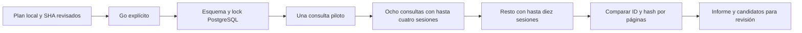

# Mapeo paralelo PROD2: preparado, pendiente de go

Este flujo consulta metadatos del Buscador SEACE, compara identidades y versiones,
y produce un informe revisable. No descarga documentos, llama modelos, usa Redis,
publica oportunidades ni reactiva PROD6. El código existente de lectura seleccionada
conserva sus límites y manifiestos históricos. El nuevo ejecutor admite hasta diez
sesiones independientes dentro de **un solo coordinador**.

## Flujo y responsabilidades



El primer bloque requiere una búsqueda JSF real, sus páginas y reconciliación
independiente; un GET 200 del formulario no acredita acceso. Cualquier bloque
incompleto detiene los siguientes. HTTP 403/429 publica STOP antes de despertar
a otros hilos; se conservan respuestas y capturas ya en vuelo. Una pérdida de
PostgreSQL o del lock detiene despachos sin reconectar automáticamente.

Todas las peticiones comparten el mismo intervalo global: 2 s en los planes
preparados, configurable entre 1 y 60 s. Diez sesiones solapan esperas de red;
no significan diez peticiones por segundo. Cada consulta mantiene su paginación
secuencial y una sesión nueva para reconciliar la primera página. Se conserva
la partición por fechas cuando el contador alcanza 499, y el bloqueo de una
partición mínima incompleta.

El pool mantiene como máximo tantos futuros pendientes como workers. Aumenta
1 → hasta 4 → hasta 10 solo después de bloques completos, sin errores. El plan
fija además máximos de peticiones, tiempo total y páginas por consulta. Alcanzar
un máximo deja cobertura pendiente; nunca se convierte en resultado cero.

## Comparación de identidades y versiones

La identidad es `id_convocatoria`, conservando su `id_procedimiento`. Dos
convocatorias del mismo procedimiento siguen siendo registros diferentes. Los
títulos iguales no fusionan convocatorias. Un cambio de procedimiento para la
misma convocatoria bloquea el lote por integridad.

| Clase | Significado |
|---|---|
| `new_id` | ID ausente del registro y de los ledgers históricos PROD2 consultados. |
| `unchanged` | ID y hash del listado iguales a la versión ya registrada. |
| `changed` | ID conocido con un hash de listado distinto. |
| `known_baseline_missing` | ID histórico conocido, pero sin un hash comparable; requiere revisión. |

El hash incluye descripción, entidad, nomenclatura, objeto, publicación,
importe/moneda e identidad. Excluye keyword, número de página y hora de consulta.
Cambios de espaciado pueden contar como cambios conservadoramente. El hash del
listado **no detecta por sí solo cambios de bases, cronograma ni estado oficial**:
esas comprobaciones pertenecen a una etapa posterior.

Las páginas de hasta 100 filas se comparan y guardan por lotes PostgreSQL. Locks
por ID, ordenados de forma estable, impiden la doble admisión concurrente. Cada
versión completa del listado y cada asociación raíz/hoja se conservan en PG.
Una observación vieja no reemplaza una nueva. Una respuesta perdida después de
commit se puede repetir sin duplicar membresías.

La primera clasificación se conserva como estadística; un cambio posterior
dentro del mismo barrido aparece además en `changed_during_run_ids` y en los
candidatos. La atribución a la primera keyword depende del orden de llegada y
no acredita relevancia comercial. El guardado de observaciones parciales no
acredita cobertura completa de una consulta.

Los tres ledgers históricos se consultan en batch: `prod2_discoveries`,
`prod2_accepted_run_members` y `prod2_jev_decision_cache`. No se modifican sus datos.
La migración 0045 prepara seis tablas de metadatos y dos índices de búsqueda por
convocatoria sobre esos últimos dos ledgers. Un índice preexistente debe tener
la estructura esperada; ocupar el mismo nombre no basta para aprobar el preflight.
Conocer un ID rechazado no basta para inventar que su contenido sigue igual;
la decisión JEV se reutilizará posteriormente por su hash de entrada, perfil,
modelo y política mediante el flujo existente. Aquí no se repaga ni se crea
ninguna reserva de modelos.

## Alcance preparado

El paquete local contiene dos alternativas que **no deben ejecutarse a la vez**:

1. **Nuevas convocatorias 2026:** 166 keywords actuales y 17 variantes industriales
   opt-in, Bien/Servicio, publicación 04–20/10/2026, año de convocatoria 2026.
   Son 366 consultas base. Recupera desde el corte digital 06/10 con dos días de
   solapamiento; incluye el corte industrial 07/10. Su cobertura se limita al
   año de convocatoria 2026: no es un censo de publicaciones recientes de años
   anteriores ni una comprobación de vigencia.
2. **Alternativa amplia:** mismos términos/fechas, años de convocatoria 2004–2026
   explícitos. Son 8.418 combinaciones base. Las pruebas de ámbito vacío,
   verificadas con dos sesiones, pueden omitir combinaciones; su capacidad real
   debe medirse. Presupuesto mayor, sin autorización implícita de correrla.

Las variantes están en `docs/sources/prod2-industrial-search-variants.v1.json`.
No cambian el perfil de DIN/VEYON ni el inventario de 166 usado en trabajos
congelados. Ocho tienen redacción respaldada por títulos ya guardados; el
rendimiento de las 17 todavía debe medirse en fuente. Permanecen opcionales.

El corte de un plan no se actualiza al ejecutar. Si el go llega otro día,
preparar un ID/plan nuevo con el corte acordado; no editar el plan anterior.
La selección de años y ventana es explícita para no ocultar un recorte de
cobertura. No se reconstruyen carpetas históricas ausentes ni se tocan las
colas conservadas de los trabajos anteriores.

## Comandos preparados

Los modos `prepare` y `validate` son completamente offline; no leen claves,
abren túneles, crean tablas ni consultan fuentes. Ejemplo:

```bash
.venv/bin/python scripts/run_prod2_parallel_discovery.py prepare \
  --plan tmp/prod2-parallel-discovery-20261020/plans/new-2026.private.json \
  --run-id prod2-map-new-20261020 \
  --from-date 2026-10-04 --to-date 2026-10-20 --years 2026 \
  --workers 10 --request-interval 2 --include-industrial-variants
```

La salida contiene el SHA canónico del plan. `validate` requiere ese SHA y
comprueba inventarios, parámetros y hashes del código/migración ejecutados:

```bash
.venv/bin/python scripts/run_prod2_parallel_discovery.py validate \
  --plan RUTA_PRIVADA_DEL_PLAN --expected-sha256 SHA_REVISADO
```

**Después del go humano**, el orden operativo es:

1. Confirmar acceso recuperado y ausencia de otro coordinador. No reintentar el
   rechazo actual como polling. El estado productivo anterior fue HTTP 403.
2. Commit/push del código validado; si se ejecuta en VM, construir desde ese
   commit remoto limpio y registrar su imagen. Una imagen vieja no admite el
   código nuevo: el digest del plan debe corresponder al checkout construido.
3. `check` consulta solo PG en read-only. Si falta la migración, preparar
   **únicamente 0045** con `apply-schema --go`, el plan y su SHA; el ejecutor
   valida la estructura y el ledger existente y toma el lock global. No llama
   `scripts/migrate.py` sobre todas las migraciones pendientes.
4. `run --go`, plan/SHA y carpeta nueva cuyo nombre coincide con `run_id`.
   El propio piloto verificará búsqueda real antes de aumentar concurrencia.

```bash
.venv/bin/python scripts/run_prod2_parallel_discovery.py check \
  --plan RUTA_PRIVADA_DEL_PLAN --expected-sha256 SHA_REVISADO \
  --ssh-host ubuntu@168.129.177.199 --ssh-key credentials/ssh-key-2026-07-14.key

# Solo si falta el esquema y después de revisar el resultado anterior:
.venv/bin/python scripts/run_prod2_parallel_discovery.py apply-schema --go \
  --plan RUTA_PRIVADA_DEL_PLAN --expected-sha256 SHA_REVISADO \
  --ssh-host ubuntu@168.129.177.199 --ssh-key credentials/ssh-key-2026-07-14.key

# Ejecución futura, no realizada durante esta preparación:
.venv/bin/python scripts/run_prod2_parallel_discovery.py run --go \
  --plan RUTA_PRIVADA_DEL_PLAN --expected-sha256 SHA_REVISADO \
  --folder tmp/prod2-parallel-discovery-20261020/runs/prod2-map-new-20261020 \
  --ssh-host ubuntu@168.129.177.199 --ssh-key credentials/ssh-key-2026-07-14.key
```

El runtime SSH obtiene solo DATABASE_URL, en memoria, desde la web; no extrae
claves de modelos ni Redis. En modo local/VM lee solo DATABASE_URL de entorno
privado. No usar la URL como argumento de shell ni imprimirla. Compose opcional:
`infra/docker/prod2-discovery.compose.yml`, perfil `prod2-discovery-only`, sin
puertos ni reinicio automático y con plan read-only. No se activó ese perfil.

## Resultado y recuperación

- `progress.private.json`: consultas completas, bloque de concurrencia y métricas
  HTTP sin URLs, cookies o cuerpos.
- `report.private.json` y `reports/report-*.private.json`: último resultado y
  recibos de ejecución conservados.
- `handoff.private.json`: IDs nuevos/cambiados/con baseline pendiente para revisión;
  si la fuente quedó incompleta, quedan retenidos y no se liberan candidatos.
  En todos los casos `automatic_paid_authorization=false`.
- `state.private.json`, páginas y pruebas de ámbito: recuperación del mismo plan.

Sin `--go` no hay conexiones. Un proceso interrumpido requiere `--resume` y el
mismo plan/SHA/carpeta. Un 403/429 guardado o una interrupción con despacho incierto
requiere además evidencia nueva y `--access-recovered`; ese flag no constituye
por sí mismo evidencia. Una falla posterior de PG/readback no borra el hold de
fuente. Un plan completado no vuelve a consultar: preparar una nueva época.

Una caché completada alterada o ausente bloquea antes de abrir HTTP. No se borra
para forzar un reintento. Las páginas parciales permanecen necesarias para
reanudar; no se limpian entradas activas, pagos inciertos ni carpetas ajenas.

## Validación y límites reales

La suite final `workers/seace/tests/test_prod2*.py` aprobó **3.104 pruebas**,
con 30 opcionales omitidas, en 62,59 s. Compose se validó offline sin iniciar
el daemon ni servicios. Ambos planes privados se prepararon y validaron con
sus SHA y bindings runtime; ningún modo `run` o `apply-schema` se ejecutó contra
producción.

Se ejecutaron pruebas offline de transporte, planificación, STOP y compatibilidad,
y pruebas reales PostgreSQL16 en un clúster loopback temporal. Los tests rechazan
DSN productivos antes de conectar, crean esquemas propios y los retiran al terminar.
Diez conexiones con 100 IDs superpuestos conservan 100 miembros y 1.000
observaciones, sin doble admisión. El driver con 1/4/10 trabajadores produce los
mismos IDs y asociaciones, y el replay completo no abre sesiones fuente nuevas.

El benchmark sintético valida concurrencia e integridad, **no latencia real ni
capacidad actual de SEACE**. No se ejecutó fuente real, migración productiva,
modelos, compra de créditos, deployment ni activación durante la preparación.
