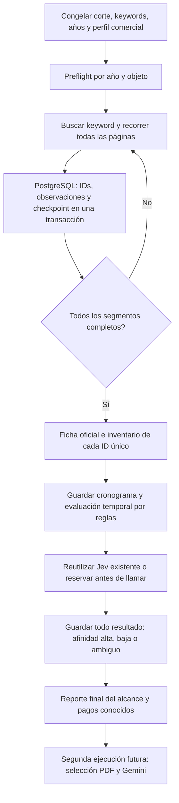

# PROD2: carga inicial de seis meses, Jev y cronogramas

**Ejecutor retirado el06/10/2026:** carga anterior cancelada definitivamente y carpeta de preflight eliminada a petición del usuario. La entrada pública devuelve `retired` antes de red/BD/modelos; solo conserva diagnóstico local y lectura de reportes históricos. Sustituido por `scripts/run_prod2_accepted.py`: Redis temporal, Jev>=60, ficha/documentos y LLM1 terminal. Véase `prod2-accepted-llm1-plan.md`. El contenido siguiente es evidencia histórica del flujo anterior y no instrucciones de ejecución vigentes.

Alcance solicitado el 06/10/2026: guardar todas las coincidencias de las 166 keywords del convenio VEYON/Dinaut en Bien y Servicio. Conservar resultados Jev, incluidos rechazos y ambiguos, ficha oficial, cronograma e inventario de documentos. PDF, R2 y Gemini se dejan para una segunda ejecución. No existe un filtro nativo de «vigente» en este recorrido.

El ejecutor es `scripts/run_prod2_ingestion.py`. PostgreSQL productivo permanece como fuente de verdad; la laptop consulta SEACE por HTTP y abre un túnel SSH privado para persistir. La VM actual continúa rechazando PROD2 con403, por lo que no se trasladó allí el colector ni se reactivaron los workers retirados.

## Ventana e inventario

- Seis meses **calendario**, con fechas inclusivas y zona America/Lima. Un inicio el06/10/2026 fija publicación06/04/2026–06/10/2026; no equivale a180días.
- Las fechas y la configuración se congelan al iniciar. Repetir el mismo comando y carpeta retoma ese corte; no desplaza la ventana al día nuevo.
- El selector nativo es **Año de la Convocatoria**. Se observó una búsqueda SOFTWARE/Servicio/año2025 con dos publicaciones de abril–octubre2026. Buscar solo año2026 perdería esos resultados.
- Por defecto se recorren todos los años numéricos disponibles en el formulario. El formulario observado ofrecía2026…2004; el código lee las opciones y no inventa ese rango.
- Un preflight sin keyword, por año/objeto y fechas acotadas, permite omitir166 consultas solamente si dos sesiones independientes devuelven cero válido. La evidencia queda congelada en el manifest. Un resultado no cero, limitado o ambiguo obliga a recorrer las keywords.
- La [configuración v4](sources/prod2-convenio-keywords.v4.json) reutiliza el inventario exacto de [166 keywords v3](sources/prod2-convenio-keywords.v3.json). No elimina señales industriales ni términos cortos como IA/API/APP; Jev conserva el contexto y el ruido queda medible.

Esto cubre el alcance de keywords y fechas configurado. No asegura recuperar toda licitación tecnológica del país ni procedimientos publicados antes de seis meses que aún estén abiertos. Los IDs abiertos ya conocidos necesitan seguimiento independiente de su antigüedad.

## Flujo implementado



La ficha se verifica antes de pagar Jev: si cambió la identidad o descripción del listado, se detiene esa tarea para importar la observación nueva. La ficha y el inventario son HTML/metadatos; esta fase descarga **cero adjuntos**. La segunda fase aún no forma parte de este ejecutor.

Por ejemplo, si una keyword trae300 filas y otra350 con270 repetidas, PostgreSQL conserva380 convocatorias únicas y sus dos procedencias. Jev evalúa380 inputs únicos como máximo, menos los resultados ya existentes. La identidad usa convocatoria/procedimiento oficiales, no título ni keyword. Una keyword nueva no cambia el input semántico ni dispara otro pago para una descripción/perfil/modelo/política idénticos.

Redis no es necesario para deduplicar. Las claves únicas, reservas, leases y checkpoints duraderos viven en PostgreSQL. El ejecutor mantiene una sola operación HTTP por sesión y espacia cada request; crear20 workers no multiplica las peticiones al portal.

## Cobertura, cambios y recuperación

La tabla nativa pagina15 filas. El contador de páginas posteriores deriva del total inicial y de los índices de fila recibidos; el portal no publica un contador nuevo en esas respuestas. Antes de persistir la última página, una sesión nueva debe confirmar el total, número de páginas, tamaño e identidad/contenido de la primera página. Si cambian, se reinicia un pass versionado, con límite y conservación del historial.

Un contador499 o mayor no se considera completo: se divide el rango de publicación en mitades inclusivas. Si una sola fecha continúa limitada, el reporte queda bloqueado; no se inventa cobertura. HTTP403/429 detiene el recorrido y conserva la causa, sin eludir protecciones.

La página y su checkpoint se confirman juntos. Al reanudar, se abre una sesión JSF nueva y se comprueba la primera página del pass persistido antes de saltar al checkpoint. No se guardan cookies, ViewState o tickets en manifests ni BD. Un advisory lock global impide ejecutar simultáneamente dos colectores de esta fase.

Jev tiene una reserva persistida antes de pagar. La respuesta privada se publica atómicamente y permite completar PostgreSQL tras un corte. Un resultado `done` se reutiliza. Si existe reserva `running/uncertain` sin respuesta, no se repite la llamada ni se atribuye coste cero: requiere conciliación. Si el corte ocurrió antes de reservar el proveedor, puede retomarse sin un pago anterior posible.

La cobertura representa passes observados, **no un snapshot transaccional de SEACE**. Una fecha sin hora conserva esa precisión. No se inventan23:59 ni porcentajes de probabilidad de adjudicación.

## Cronograma y participación

Se conservan todas las etapas originales, fechas, textos y precisiones en la ficha. La evaluación temporal, con hash de ficha y fecha de evaluación, distingue registro de una empresa nueva y presentación condicionada a inscripción previa. Estados posibles: `pending_registration`, `registration_open`, `registered_only`, `submission_open`, `closed`, `adjudicado`, `cancelado`, `desierto`, `suspendido`, `unknown`.

«Convocado» por sí solo no equivale a abierto. Fechas incompletas, horarios no precisos en el límite, etapas contradictorias, modalidades por invitación/directa/consultoría individual y estados de ítems mixtos conservan `unknown` cuando corresponde. La evaluación no acredita inscripción, habilitación ni capacidad de las empresas. La programación de Buena Pro no prueba su otorgamiento ni identifica al ganador.

## Ejecución

Requiere el entorno Python existente `.venv`, las migraciones0035/0036/0037 y la clave Jev en `.env.jev.local` como `TYPESAFE_API_KEY`. El script no imprime secretos. Los manifests, recibos y reportes se guardan en carpeta700/archivos600, bajo `tmp/` ignorado por Git.

Plan local sin red, BD o modelos:

```bash
.venv/bin/python scripts/run_prod2_ingestion.py --production --folder tmp/prod2-six-months-20261006 --dry-run
```

Carga del alcance completo y reanudación con el mismo comando:

```bash
.venv/bin/python scripts/run_prod2_ingestion.py --production --folder tmp/prod2-six-months-20261006
```

Reporte duradero sin consultar SEACE ni Jev:

```bash
.venv/bin/python scripts/run_prod2_ingestion.py --production --folder tmp/prod2-six-months-20261006 --report-only
```

Un `--keyword software --years 2026 --objects good --from-date 2026-10-01 --to-date 2026-10-05 --skip-preflight` define una corrida de validación **diferente**. `--max-work-items 1` permite un corte controlado y nunca se presenta como carga completa. Cambiar corte/keywords/objetos/años/configuración exige una carpeta nueva. El reporte diferencia evaluaciones existentes, reservas iniciadas en esta corrida y facturación desconocida; los costes guardados son estimaciones, no factura del proveedor.

## Después de la carga

Antes del mantenimiento diario, cubrir el puente desde el corte inicial menos siete días hasta un corte nuevo. Si la carga tarda varios días, no reducir ese puente al último tramo de siete días. Después, mantener las166 keywords en Bien/Servicio sobre una ventana solapada de siete días, conservar los años de convocatoria necesarios y ampliar la recuperación tras paradas largas. Refrescar fichas conocidas cerca de su cierre y revisar periódicamente publicaciones atrasadas. Este planificador recurrente/puente sigue pendiente; el ejecutor actual realiza una corrida congelada.

## Evidencia de validación

- **643 pruebas offline aprobadas**; dos contratos PG opt-in se omiten en la pasada normal. El contrato nuevo se ejecutó aparte: **1 passed**, schema temporal con rollback,16 candidatos y dos keywords, sin llamadas a SEACE/modelos ni alteración de secuencias públicas.
- Cliente HTTP verificado con página2 real SOFTWARE/Servicio/2026: total198, índices15–29 y ViewState nativo renovado. Año2025 con igual keyword/ventana devuelve2; sin keyword devuelve156. Es evidencia acotada05abril–05octubre2026, no conteo global vigente.
- Migración0037 aplicada en producción por SHA256 `e383bdd58f1ed31d1db7f853ddbeed1baf0f138c74c66277e821035edc3dada3`, en una transacción con registro de versión. Preservó las10 discoveries y50evaluations anteriores.
- Smoke real `prod2-metadata-smoke-20261006`: SOFTWARE/Bien/año2026/publicación01–05octubre, **3 IDs**,1 tarea discovery y3 enrichment completas. **2 registration_open y1 unknown**; eligibility empresarial no verificada. Los tres Jev fueron reutilizados;0 reservas/pagos nuevos,0 PDFs y0 llamadas Gemini. La repetición terminó con iguales conteos, sin consultas de ficha ni llamadas al proveedor.
- La auditoría posterior confirmó10 discoveries/50evaluations/10descargas/10extracciones previas y3 evaluaciones temporales nuevas. No se reactivaron workers legacy ni se desplegó código web en esta fase.
- **Carga general iniciada** desde laptop en `tmp/prod2-six-months-20261006`, PID70049: seis meses06abril–06octubre2026,166 keywords, Bien/Servicio y todos los años nativos. Log privado `progress.private.log`, recibo de proceso `job.private.json`. Estado al registrar: inicialización/preflight; los ámbitos2026 y2025 observados hasta entonces no estaban vacíos. Se evita suspensión por inactividad mientras corre; la laptop debe conservar conexión y permanecer encendida.

**Pausa solicitada por el usuario el06/10/2026:** se detuvo el proceso70049 y se verificó que su grupo no mantiene procesos activos. Se encontraba en preflight, antes de crear el manifest del lote y comenzar discovery/Jev general. Los recibos y avances privados se conservan para una reanudación autorizada posterior.

La carga general solo se declara finalizada cuando su reporte duradero lo confirma; está pausada e incompleta. Un lote pequeño no cierra ese trabajo ni da un conteo total de vigentes. El plan recurrente de últimos siete días y PDF/Gemini de segunda fase siguen pendientes.
