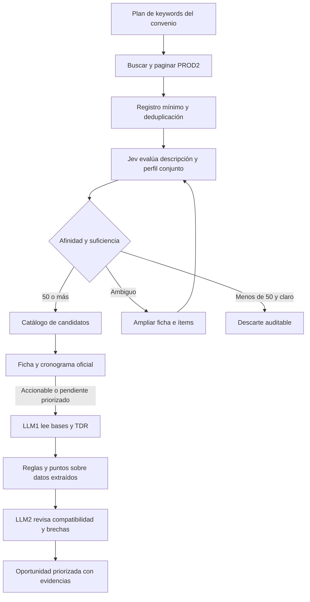

# Arquitectura PROD2 para el perfil comercial del convenio

El radar de esta propuesta consulta exclusivamente Procedimientos de Selección en PROD2. Usa un único perfil comercial del convenio VEYON y Dinaut para descubrir y priorizar oportunidades. El flujo acordado es búsqueda por keywords, filtro Jev de afinidad, ingreso al catálogo de candidatos, lectura documental LLM1, comparación por reglas y revisión LLM2.

La configuración conjunta expresa qué proyectos interesa atender y cómo se distribuyen comercialmente. No crea una nueva persona jurídica ni modifica los perfiles productivos existentes. Para evaluar requisitos, se conserva quién postula y qué integrante aporta cada evidencia. El usuario aclaró el alcance del convenio el 5 de octubre de 2026; este diseño sustituye la propuesta anterior de múltiples fuentes y dos evaluaciones comerciales separadas.

## Perfil conjunto

Definir `commercial_group` como una configuración versionada de búsqueda y afinidad. Contiene descripción comercial conjunta, líneas y entregables aceptados, keywords y frases, exclusiones contextuales, prioridad y presupuesto. Los nombres son propuestas de diseño; no se crearon tablas o registros productivos.

El catálogo conserva rubro, subrubro y entregable. Por ejemplo, tecnología → software → desarrollo, licencias o soporte. El alcance actualizado del radar incorpora todas las líneas activas de Dinaut, incluidas industria, y las de VEYON principal. Esa ampliación cambia el perfil comercial y su hash de evaluación. Una keyword puede descubrir una coincidencia sin demostrar afinidad real.

Una oportunidad tiene una sola afinidad preliminar contra ese perfil comercial conjunto. La evidencia para evaluar cumplimiento conserva integrante, titular, documento, alcance, fecha, moneda y respaldo. El software usa esa procedencia para explicar quién cubriría un requisito y qué falta comprobar en las bases; no suma importes o capacidades automáticamente por existir un convenio.

## Flujo

La rama de ampliación no es un bucle ilimitado: cada versión de ficha puede aportar nuevos inputs; si no aporta información suficiente, se conserva pendiente con motivo y próxima revisión. Una etapa cerrada o suspendida conserva el registro y evita lectura documental innecesaria para el radar vigente. Una fecha desconocida permanece pendiente, sin inventar un cierre.

### Búsqueda por keywords

Un planificador rota consultas compartidas del convenio: términos específicos, frases y términos amplios priorizados. Normalizar consultas equivalentes y reutilizar resultados. Guardar keyword, rango de publicación, página/partición, última ejecución exitosa y límite alcanzado.

El [plan concreto de barrido y persistencia](prod2-keyword-discovery-plan.md) incluye las 166 keywords únicas del convenio, 73 digitales y 93 industriales. Primero se cargan 2026 hasta el corte T0 y 2025 completo: 664 combinaciones año/keyword/objeto más páginas y particiones. Después de validar discovery y recuperar publicaciones durante la carga, todas se consultan en Bien y Servicio al menos una vez por vuelta diaria: 332 combinaciones base más páginas y particiones. Los 24 bloques horarios distribuyen la carga sin probar capacidad; [configuración versionada de propuesta](sources/prod2-convenio-keywords.v3.json). El ejemplo 300/350 detalla el upsert y las reservas antes de Jev.

La búsqueda inicial necesita ventanas suficientemente amplias para encontrar procesos todavía abiertos. Luego combina novedades con solapamiento, seguimiento de IDs ya abiertos y reconciliación periódica del alcance. Buscar por software y términos asociados no garantiza recuperar todas las compras de software; medir cobertura y ampliar consultas según falsos descartes y oportunidades omitidas.

#### Barrido por keywords y fechas

Proponer dos recorridos complementarios. El primero rota keywords configuradas por familias digitales e industriales: software/desarrollo, licencias, nube, datos, IA, control industrial, electricidad, instrumentación, redes, robótica, puesta en marcha y capacitación. Son ejemplos de vocabulario, no sintaxis OR ni sinónimos garantizados del buscador: cada consulta se prueba por separado. Registrar nuevos IDs únicos por consulta, solapamiento y oportunidades pertinentes omitidas; conservar una cuota de exploración para términos de bajo rendimiento.

El segundo recorre publicaciones por fechas y objetos permitidos, sin descripción, para encontrar objetos que no usan nuestras palabras. Puede requerir clasificar nuevos registros con Jev dentro de presupuesto, sin descargar todos sus documentos. Partir ventanas amplias en periodos menores ante sospecha de truncamiento; si una partición mínima sigue incompleta, mantenerla pendiente y usar dimensiones verificadas disponibles. Completar todas las páginas y comprobar consistencia antes de declarar una partición cubierta. La deduplicación identifica solapamientos, pero no demuestra ausencia de registros omitidos.

El arranque usa un manifest congelado de keywords, objetos, años y corte T0. El gate exige persistencia, identidad, páginas y particiones completas, sin esperar Jev o los LLM. Jev queda reservado hasta completar discovery. Un puente desde T0 menos siete días recupera publicaciones durante la carga; una frontera H duradera y un próximo job/outbox se confirman junto con el cambio a mantenimiento. Si carga, puente o parada duran más de siete días, recuperar desde H con solapamiento antes de usar solamente la ventana reciente. El arranque incluye además fichas que determinen vigencia. Seguimiento de IDs abiertos y reconciliación amplia detectan cambios y reaperturas. Distinguir cobertura completa de particiones seleccionadas de cobertura de todo PROD2: esta última no está demostrada, ni la garantiza un diccionario de keywords.

Conservar el resultado mínimo y consultar caché antes de encolar Jev. Una restricción única por objeto/contexto/perfil/rúbrica/modelo y claim atómico impide que keywords concurrentes dupliquen evaluaciones en curso; persistir el resultado evita repetir las terminadas. Fallos con resultado remoto incierto pueden duplicar costo al reintentar y deben registrarse.

PROD2 requiere una sesión JSF y ViewState coordinados. El [cliente HTTP probado desde el Mac](sources/prod2-http-flow-20261005.md) completó búsqueda, ficha y cuatro descargas sin navegador; usa los postbacks nativos y valida contenido/identidad. Empezar con una sesión HTTP y operaciones secuenciales. Los workers de Jev y documentos son independientes de esa sesión. No distribuir su paginación entre búsquedas concurrentes que mezclen el estado.

Validar que cada consulta haya terminado y tenga la estructura esperada. Una respuesta HTTP 200 no basta para declarar éxito. Frente a bloqueo o intervención requerida, preservar checkpoint y registrar la consulta pendiente. Ante posible truncamiento, subdividir fechas y dimensiones disponibles, conservando una métrica de cobertura incompleta.

### Registro mínimo antes de Jev

Deduplicar por ID oficial de procedimiento y mantener convocatoria e ítems cuando estén disponibles. El título no identifica una licitación. Guardar en PostgreSQL un registro técnico mínimo aunque no ingrese al catálogo visible: ID, hash de objeto, observación, keyword de origen, estado del filtro y resultado/versiones Jev.

La puerta de entrada de 50/100 controla el catálogo de candidatos y el presupuesto profundo, no la existencia del registro de discovery. Esto evita pagar otra vez cuando diez keywords encuentran el mismo objeto rechazado y permite medir descartes. Si cambia texto, contexto o perfil conjunto, el rechazo anterior puede reevaluarse.

### Filtro Jev de la descripción

Enviar objeto y datos livianos disponibles junto con la descripción comercial del convenio. Formular preguntas separadas de rubro/entregable, afinidad comercial y suficiencia de información. Comparar el objeto principal, no subcadenas o palabras aisladas. IA no coincide dentro de cirugía; seguridad física no es ciberseguridad; una carrera de informática no es una contratación de software.

Definir `affinity_threshold = 50` como parámetro propuesto, con comparación inclusiva `affinity_index >= 50`. Es un índice comercial de 0 a 100, separado de confianza y probabilidad de adjudicación. Una descripción clara que alcanza el umbral entra al catálogo de candidatos. Por debajo del umbral queda con descarte comercial auditable.

Recomendar prioridad alta desde 60, manteniendo la excepción de información insuficiente. Umbral y prioridad son propuestas por validar con el perfil conjunto, no una calibración demostrada. Cambiar solo el umbral reevalúa decisiones con scores guardados y no requiere otra llamada Jev; separar la versión de decisión del prompt/rúbrica que produjo el score.

La excepción propuesta es información insuficiente, compra mixta no resuelta o resultado dudoso según umbrales calibrados: ampliar ficha/ítems antes de decidir o conservar pendiente. En la prueba anterior, mantenimiento de sistemas tuvo afinidad aproximada 29 con información insuficiente; rechazarlo exclusivamente por el umbral podría perder una oportunidad válida. La confianza y suficiencia se registran aparte.

El umbral es una puerta para investigar, no el resultado final. La prueba existente evaluó Dinaut; el perfil conjunto y sus umbrales requieren una prueba propia. Fijar modelo, formato, política y catálogo. El caso ITSM cambió 11,75 puntos entre lote e individual: validar estabilidad antes de usar lotes grandes de objetos distintos. [Score de Jev](https://docs.typesafe.ai/primitives/score).

### LLM1 para leer la licitación

Después de ingresar como candidato, ejecutar una etapa independiente de enriquecimiento de ficha/ítems/cronograma e inventario documental y guardar ese snapshot en PostgreSQL antes de obtener las bases/TDR pertinentes. Comprobar vigencia y modalidad/tipo de participante: afinidad tecnológica no acredita que una empresa pueda postular a una consultoría individual. La [prueba de ficha y documento](sources/prod2-detail-enrichment-probe.md) verificó una descarga oficial y lectura LLM1/revisión LLM2, con datos guardados solo localmente; la persistencia productiva del adaptador sigue pendiente. No prometer extraer toda la información desde el título: registrar archivos obtenidos, versiones faltantes y calidad de lectura. La vigencia operativa depende del estado, fechas, canal y condiciones de participación oficiales.

La captura estructurada de ficha, cronograma y enlaces no usa LLM y se persiste antes del análisis documental. Separar etapa/fechas de Buena Pro y documentos listados del resultado adjudicado/ganador confirmado. Las referencias conservan procedencia, método de acceso y fecha de verificación; los enlaces JSF pueden requerir contexto. Se verificó además la descarga HTTP del mismo TDR sin cookies desde el Mac mediante el resolver documental oficial; su URL final incluye un ticket que se regenera y no se expone como enlace permanente. La primera prueba local no acreditó acceso desde otros orígenes o a todos los archivos. Un cambio de cronograma no vuelve a gastar tokens en un documento idéntico.

Actualización de acceso: la [prueba de la VM productiva](sources/prod2-vm-access-probe.md) del 05/10/2026 obtuvo HTTP 403 en buscador, ficha y cuatro resolvers, sin descarga. El transporte de lectura de esta propuesta requiere un origen permitido y validado; el acceso desde el Mac no acredita el acceso productivo. No se activó el colector ni se modificó la pausa operativa.

LLM1 produce datos estructurados: objeto, entregables, alcance técnico, modalidad, plazos, presupuesto si consta, requisitos, experiencia, profesionales, certificaciones, fabricantes y condiciones de participación. Cada requisito tiene ID y referencia al archivo/página o ubicación de origen. Registrar ausencias, contradicciones o lectura incompleta; los datos no encontrados se marcan desconocidos.

Deduplicar lectura por documento original y versión del extractor. Actualizar extracción si cambian las bases. Una URL que cambia de contenido no conserva automáticamente la extracción anterior. Un archivo grande o ilegible mantiene estado pendiente con motivo; no se declara leído por haber descargado el enlace.

### Reglas y puntos después de LLM1

La revisión de keywords del usuario ocurre sobre lo extraído por LLM1. Usar frases, familias y términos completos para asignar puntos de afinidad al alcance, entregables, modalidad y especialidad. Una palabra repetida no suma puntos indefinidamente y una mención incidental no acredita que el objeto sea software.

No convertir este segundo filtro en un rechazo irreversible por ausencia de una palabra exacta. Sinónimos o descripciones equivalentes pueden ser pertinentes; conservar criterio y motivo, y dejar pendientes los casos contradictorios.

Separar afinidad comercial de comprobación de requisitos. Las reglas calculan importes, fechas, versiones y coincidencias verificables a partir de evidencias con procedencia. Requisitos críticos, datos desconocidos y condiciones pendientes se conservan individualmente; un buen puntaje comercial no los borra. Pesos y umbral de priorización documental se definen tras revisar casos, sin inventar que son porcentajes exactos de cumplimiento.

### LLM2 para revisar y explicar

LLM2 recibe extracción actual, perfil del convenio, evidencias identificadas por integrante y resultados de reglas. Revisa compatibilidad y propone brechas/acciones por requisito, con citas y estado de respaldo. La salida puede distinguir sustentado, incompatible, pendiente de evidencia y no aplica, según el contrato de evaluación validado.

La evaluación debe reconocer qué participante tiene el respaldo y qué condiciones de las bases faltan revisar. No fabricar experiencia, autorizaciones o vigencia por una declaración comercial. Las condiciones para usar capacidades de otro integrante se comprueban contra las bases y el modo de participación concreto.

LLM2 no es una fuente infalible de verdad. Su explicación se valida por cobertura de requisitos, referencias, consistencia con reglas y evidencia. Si faltan datos, informa pendiente. Los resultados importantes incluyen objeto entendido, afinidad, requisitos sustentados, brechas, bloqueos y próximas acciones; una cifra sola no reemplaza esos hechos.

## Persistencia y workers

Mantener PostgreSQL como fuente de verdad y reutilizar `worker_jobs`, sus prioridades, dedup activo y backoff. Propuestas de registros: configuración comercial conjunta, consultas/checkpoints PROD2, registros mínimos de discovery, decisiones Jev, candidatos, extracciones y evaluaciones del convenio. Armonizar con `opportunities` y el modelo existente antes de crear migraciones.

| Resultado | Datos que identifican su versión |
|---|---|
| Jev preliminar | Hash del objeto/contexto + hash comercial conjunto + política/modelo/esquema/formato |
| LLM1 | SHA original + clase documental + extractor/modelo/prompt/esquema |
| Puntos de afinidad documental | Extracción actual + perfil conjunto + versión de reglas |
| LLM2 | Requisitos actuales + evidencia de participantes + reglas + prompt/modelo/esquema |
| Vigencia | Identidad de convocatoria/ítem + versión del estado/cronograma |

Cambiar una fecha solo actualiza vigencia. Cambiar el alcance del convenio reevalúa afinidad sin volver a descargar todo. Cambiar una evidencia invalida su comprobación, no la lectura del documento público. La caché dura mientras coincidan los inputs y versiones, no solo mientras exista un job activo.

Punto de partida: un scheduler, una sesión HTTP PROD2, una plaza de Jev y una documental LLM1/LLM2 con prioridades separadas; un consumidor liviano de reglas reutiliza servicios existentes. Ampliar las plazas de modelos según edad de cola y presupuesto, manteniendo la sesión PROD2 secuencial. Incorporar lease/heartbeat y recuperación de jobs abandonados antes de aumentar concurrencia.

El [dimensionamiento de VM y workers](prod2-deployment-sizing.md) ofrece dos opciones de piloto: colector separado, recomendado 4 vCPU/8 GB/80 GB SSD, o sistema completo con margen para 10–20 procesos livianos, recomendado 8 vCPU/16 GB/160 GB SSD. Son estimaciones, con una sesión JSF y concurrencia documental limitada; no una prueba de carga. La VM actual presentó dos CPU lógicas/11,65 GiB y baja carga en el snapshot; el rechazo 403 requiere resolver acceso, no está explicado por saturación en esa medición. Validar primero el flujo real desde la IP asignada por el proveedor.

La carga general y el puente preceden a la activación diaria. Jev se libera tras completar discovery, en paralelo al puente; las lecturas documentales siguen por sus propias colas. Los modelos no bloquean la transición a mantenimiento. Las cadencias de mantenimiento son metas de piloto: vuelta de todas las keywords cada 24 horas sobre publicaciones de los últimos siete días; reconciliación sin keyword diaria; fichas abiertas cada cuatro horas con presupuesto propio y más frecuente cerca de cierre; recorrido amplio de 2026/2025 con objetivo semanal. Las prioritarias pueden repetirse cada dos horas solo si sobra capacidad tras las cuotas esenciales. Guardar avance y retraso si la fuente impide terminar. Las cadencias requieren medición; la ventana diaria no cubre todos los procedimientos antiguos vigentes. Jev y los LLM se ejecutan ante inputs nuevos/cambiados y reutilizan resultados.

## Validación y estado

Propuesta revisada contra el estudio PROD2, el benchmark Jev y las piezas existentes del worker. Antes de implementar el umbral: etiquetar casos independientes del convenio y medir especialmente falsos descartes bajo 50, ambigüedad y desplazamientos por formato. Revisar muestras de descartes y registrar qué consultas/particiones están completas.

Validar que tres keywords produzcan una única evaluación del objeto intacto; que 50 entre y menos de 50 claro quede fuera del catálogo; que ambiguo pueda ampliar sin bucle; que campos faltantes no se inventen; que las referencias LLM1/LLM2 cubran los requisitos; que cada evidencia conserve titular; y que un fallo pueda retomar el trabajo.

La arquitectura está documentada. El transporte HTTP acotado de búsqueda/ficha/documentos está implementado y probado desde la laptop; falta paginación general, persistencia y el perfil/pipeline conjunto, que no están desplegados. No se ejecutaron jobs, nuevas llamadas pagadas, cambios de perfil o escrituras de negocio durante esa prueba HTTP. La planificación de PROD2 no modifica automáticamente la pausa previa de Dinaut o su ingesta en otros portales.

## Referencias

- [Estudio de acceso y cobertura PROD2](sources/003-seace-buscador-publico.md).
- [Prueba real del filtro Jev](jev-description-filter-benchmark-20261005.md).
- [Comparación de evaluadores de requisitos](gap-evaluator-benchmark-20261005.md).
- [Cola PostgreSQL](../workers/seace/src/buenapro_worker/queue/repository.py).
- [Identidad canónica existente](../db/migrations/0027_opportunity_identity.sql).
